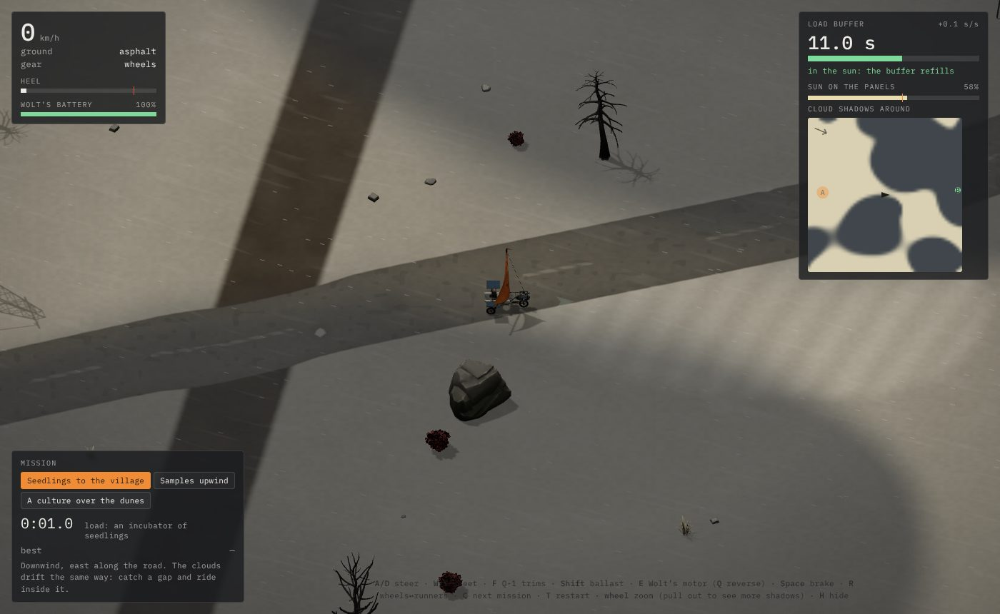
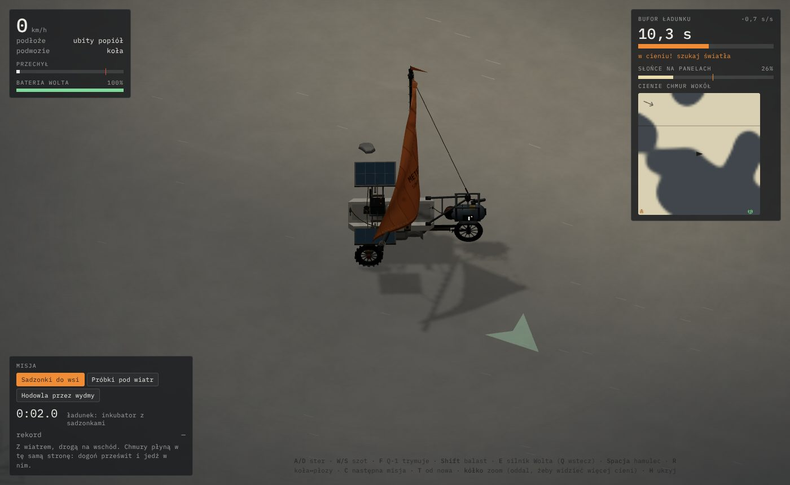

# Tech demo „Słońce” (`/demo-sun/`)

Link: https://wjurkowlaniec.github.io/power-and-ash/demo-sun/ (po angielsku: dopisz `?lang=en`).

Poligon zręcznościowej misji przewozu. Pomysł Wojtka (2026-11-11, sparafrazowany):

> Elementy zręcznościowe: misje albo sytuacje, w których trzeba przewieźć coś z miejsca na miejsce, a to coś musi być cały czas oświetlone, bo jedziesz na panelach słonecznych. Na przykład Żaglowóz z panelami musi utrzymać zasilanie, bo coś wiezie. Na niebie są chmury. Jest jakiś zapas, np. 20 sekund bez zasilania, ale ogólnie trzeba trzymać się jasnego miejsca i znaleźć drogę.

## Co jest w demie

- **Ten sam Żaglowóz i ta sama mapa co w „Żegludze”** (fizyka, wiatr, teren, Wolt jako przednie koło, balast, olinowanie), a do tego dwa panele słoneczne na wysięgnikach po bokach wózka i ładunek na pokładzie: skrzynka ze szklaną pokrywą i lampką stanu (zielona w słońcu, pomarańczowa w cieniu, czerwona i migająca, gdy bufor się kończy).
- **Chmury widać tylko po cieniach.** Każda chmura to luźna grupa miękkich kłębów. Całe niebo płynie z wiatrem (wolniej niż wiatr przy ziemi i wolniej, niż jedzie Żaglowóz), a kłęby powoli puchną i kurczą się, więc prześwity otwierają się i zamykają. Cień ma miękki brzeg kilku metrów. Pod chmurą na panele dochodzi 12% światła.
- **Bufor ładunku: 20 s pełnego cienia.** Ładunek potrzebuje 55% słońca. Poniżej bufor się wyczerpuje (w pełnym cieniu dokładnie 1 s na sekundę, na brzegu chmury wolniej), powyżej odnawia się (w pełnym słońcu 2,2 s na sekundę, czyli od zera do pełna w ok. 9 s). Pusty bufor = ładunek stracony, misja od nowa (T).
- **Nadmiar słońca idzie do baterii Wolta**, gdy bufor jest pełny (albo nic nie wieziesz). Dzięki temu silnik Wolta (E) jest wyjściem awaryjnym: gdy wiatr siądzie w cieniu, można wypchnąć się na słońce.
- **Misje A → B.** Podjedź do A i zatrzymaj się w kręgu (1,5 s załadunku), potem do B i znów stań (1,5 s rozładunku). Zegar liczy od załadunku, rekord zapisuje się w przeglądarce.
  1. **Sadzonki do wsi** (inkubator): z wiatrem drogą na wschód, mniej chmur. Chmury płyną w tę samą stronę, więc można dogonić prześwit i jechać w nim.
  2. **Próbki pod wiatr** (chłodziarka): ze wsi pod wiatr na zachód, do skraju lasu. Trzeba halsować, a cienie płyną prosto na ciebie: czasem lepiej przeczekać w słońcu na lukę.
  3. **Hodowla przez wydmy** (szklana hodowla mchu): przez solnisko i wydmy, więcej chmur i szybszych. Na wydmach lepsze płozy, ale na płozach silnik Wolta nie pcha.
- **Czytanie drogi**: mapka „Cienie chmur wokół” (±130 m, północ u góry, strzałka wiatru w rogu, A i B), pasek „Słońce na panelach” z kreską progu 55%, licznik bufora z tempem (+/− s/s). Gdy Żaglowóz wjeżdża w cień, słońce na nim przygasa, a brzegi ekranu lekko szarzeją i chłodnieją (estetyka mglista jak w Inside). Kółko myszy oddala widok, żeby widzieć więcej cieni.
- Dźwięki: wejście w cień, powrót na słońce, cichy tik, gdy bufora zostaje mniej niż 6 s.

## Sterowanie

Jak w „Żegludze”: **A/D** ster, **W/S** szot, **F** Q-1 trymuje, **Shift** balast, **E** silnik Wolta (**Q** wstecz), **Spacja** hamulec, **R** koła↔płozy, **kółko** zoom. Do tego: **C** następna misja (albo przyciski w panelu „Misja”), **T** od nowa, **H** ukryj pomoc, **M** wycisz.

Linki: `?mission=seedlings` | `samples` | `culture` wybiera misję, `?go` pomija kartę startową, `?debug` wystawia `window.sun` (stan gry) do testów.

## Kod

| Plik | Co robi |
|---|---|
| `src/sun/sim/clouds.ts` | `CloudField`: chmury z kłębów na niebie-torusie 640 m, dryf z wiatrem, oddychanie kłębów, `shadeAt` / `lightAt`. Czysty TS, deterministyczny dla ziarna. |
| `src/sun/sim/missions.ts` | trzy misje: ładunek, A, B, zachmurzenie, prędkość chmur, ziarno nieba |
| `src/sun/sim/sunGame.ts` | `SunGame extends SailGame`: chmury, światło na panelach, bufor (`bufferRate`), fazy dostawy, ładowanie baterii Wolta, rekordy. Liczby w `SUN`. |
| `src/sun/render/sunView.ts` | warstwa cieni chmur przylegająca do terenu (shader z tymi samymi kłębami i progiem co logika), przygasanie słońca, panele i ładunek na Żaglowozie, kręgi A/B z paskiem załadunku, strzałka do celu |
| `src/sun/main.ts`, `sun.css` | HUD (bufor, słońce, mapka cieni, misje), wejście, dźwięki |
| `test/sun.test.ts` | zachmurzenie, dryf i zawijanie nieba, tempo bufora, 20 s w cieniu, przeżycie krótkiego cienia, załadunek i rozładunek, ładowanie Wolta, misje z dala od przeszkód |

Demo nie zmienia logiki „Żeglugi”: korzysta z `SailGame` i `SailView` (jedyny dodatek w `src/sail/` to getter `SailView.yachtRoot`, żeby zawiesić panele na kadłubie). Zmiany w `src/sail/` mogą wpłynąć na to demo, więc `npm test` sprawdza oba.

## Do sprawdzenia przez Wojtka

- Czy 20 s bufora i 55% progu dają dobre napięcie, czy chmury są za gęste lub za rzadkie, za szybkie lub za wolne.
- Czy cienie są czytelne na popiele, czy mapka cieni nie psuje zabawy (może ma być ulepszeniem: „czujnik nieba”).
- Czy ten typ misji ma wejść do gry jako dostawy dla bunkrów (np. sadzonki dla Kopuły, leki w chłodziarce), i czy panele mają być stałym wyposażeniem Żaglowozu, czy ulepszeniem.
- Pomysły na rozwinięcie: nocą zamiast słońca latarnie albo księżyc, burza piaskowa jako „chmura” przy ziemi, ładunek, który potrzebuje cienia (przegrzewa się w słońcu), panele obracane do słońca.
