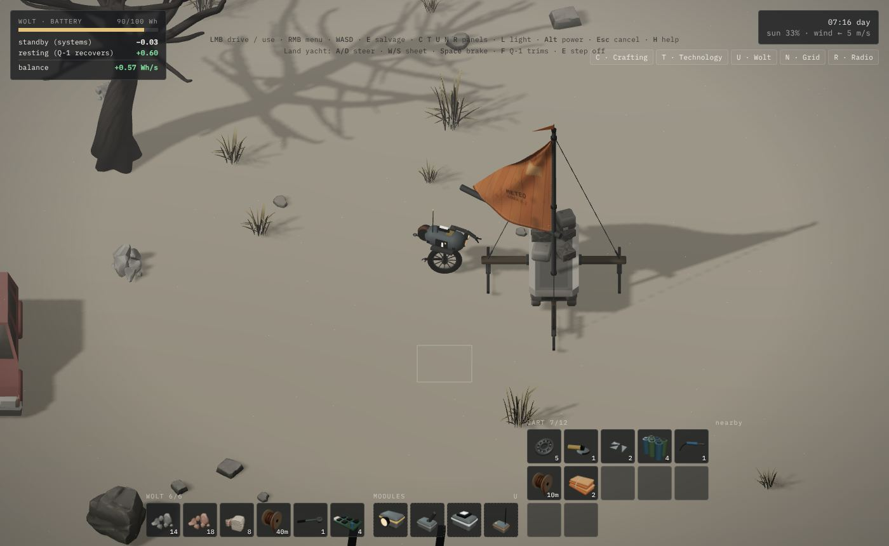
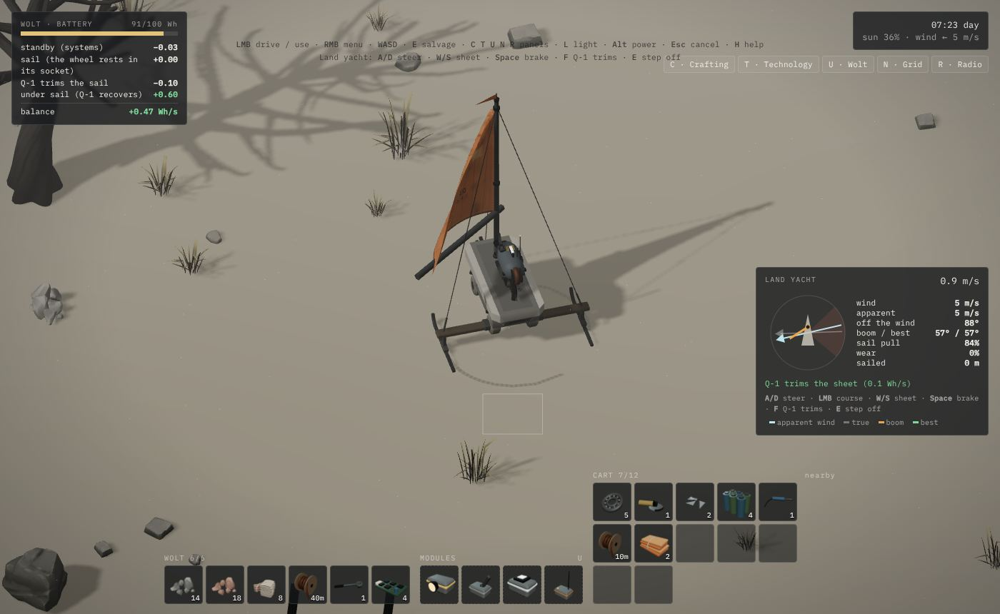

# Tech demo „Warsztat”: wytwarzanie, ekwipunek, technologie, ulepszenia Wolta

**Adres:** https://wjurkowlaniec.github.io/power-and-ash/demo-craft/ (`?stage=N` otwiera etap N od zera, `?lang=en` po angielsku)

Drugie tech demo, obok „Rozruchu” (`/demo/`). Powstało na prośbę Wojtka z 2026-11-08: „zrób drugie tech demo, skupione na craftingu, rozwoju postaci i tak dalej, żeby można było wszystkie etapy po kolei zobaczyć. Zaszalej.” To poligon systemów, nie fragment fabuły: sprawdzamy, jak się gra małym ekwipunkiem, wózkiem, rozbiórką, narzędziami, siecią z rozgałęźnikami, maszynami, drzewkiem technologii, modułami Wolta i anteną. Od 2026-11-09 („dorób w tech demo budowanie statku z żaglem”) także budową Żaglowozu z wózka i żeglugą po popielnej równinie (zob. [Żaglowóz](#żaglowóz)). Co z tego przejdzie do gry, decyduje Wojtek (zob. [Czeka na decyzję](#czeka-na-decyzję)).

## Co jest w demie

| System | Jak działa w demie |
|---|---|
| **Ekwipunek** | Wolt ma **6 miejsc**. Każdy przedmiot ma rozmiar stosu (surowce 20, kabel 40 m, części 5–10, narzędzia i moduły 1). Co się nie zmieści, spada obok Wolta w pakunku, który można podnieść później. |
| **Wózek serwisowy** | Stoi przy warsztacie z zatartymi kołami. Naprawa: 2 łożyska + 2 żelaza. Daje **+12 miejsc** i jest jedynym miejscem na rzeczy **duże (XL)**: panel, turbina, magazyn, kołyska, przetwórnia, maszt. Działa, gdy jest doczepiony do haka (E) albo stoi bliżej niż 3,2 m. Jedzie za Woltem na linie (wspólne `towDrive`), spowalnia go o 15%. |
| **Rozbiórka** | LPM na złomie albo przytrzymane E obok. Złom ma rodzaj, czas, łup, potrzebne narzędzie i **obserwacje** dla Q-1. Duże rzeczy (wrak auta, panel, kontener) rozbiera się w kilku rundach, model osiada z każdą rundą. Zakopany kabel widać dopiero z modułem AI II. |
| **Narzędzia** | Klucz (beczki, kontenery, panele, szafy), przecinarka (wraki aut, latarnie; ciągnie 2,5 Wh/s z Wolta), lutownica (płytki, moduły), miernik (pokazuje przepływ prądu na kablach). |
| **Wytwarzanie** | Panel C. Przepisy „ręczne” (kabel, klucz, rozgałęźnik) wszędzie, „stołowe” tylko przy stole warsztatowym. Stół z prądem pracuje 2× szybciej i nie ciągnie z baterii Wolta. Przycisk ×5 robi serię. |
| **Technologie** | Panel T, drzewko 14 węzłów. Technologia wymaga poprzednich i **obserwacji** (Q-1 musi coś rozebrać i obejrzeć), a potem **obliczeń** w Wh. Q-1 liczy tylko, gdy bateria Wolta ma ponad 50% (nadwyżka), i zużywa wtedy 1,5 Wh/s (moduł AI II: 2× szybciej). To jest wersja z decyzji „rozwój = obserwacje + obliczenia w tle” ([SWIAT.md: Rozwój](SWIAT.md#rozwój-obliczenia-w-tle)), tylko pokazana jako drzewko, żeby dało się ją oglądać i testować. |
| **Sieć** | Każda budowla ma gniazda (rozgałęźnik 4, latarnia i magazyn 2, reszta 1). LPM na maszynie bierze kabel z gniazda, kabel owija się o przeszkody (wspólny `Cable`), LPM na drugiej maszynie wpina. Zużyte metry schodzą z ekwipunku, odcinek maks. 30 m. Bilans każdej sieci (wspólne `solveNetworks`): produkcja, pobór, magazyn. Magazyny biorą nadwyżkę i pokrywają niedobór. Gdy zabraknie prądu, cała sieć gaśnie. Panel N, Alt pokazuje przepływ. |
| **Maszyny** | Stara turbina warsztatu (do naprawy: silnik + 2 łożyska, ≤180 W od wiatru), panel słoneczny (≤400 W od słońca), turbina wiatrowa (≤300 W), latarnia (40 W nocą), magazyn energii (2 kWh), kołyska ładująca (300 W, ładuje Wolta 5 Wh/s przez styki, nigdy indukcyjnie), przetwórnia złomu (500 W, sama rozbiera złom mieszany na surowce), maszt antenowy (200 W). Budowle stawia się z ekwipunku (klik na przedmiot w doku → Postaw), można je rozebrać i zabrać z powrotem. |
| **Doba** | 6 minut na dzień i noc (przycisk „czas ×4 / ×16” przyspiesza). Słońce zasila panele, nocą świecą latarnie i Wolt. |
| **Ulepszenia Wolta** | Panel U. Gniazda modułów: 2 na start, +1 z „Moduły Wolta”, +1 ze „Zdalnego sterowania”. Moduły: reflektor (2× dalsze światło), wzmocnione ramię (rozbiórka −40%), dodatkowe ogniwa (+100 Wh), radio (do masztu), zdalne sterowanie (przełączanie maszyn z panelu sieci), **AI II** (Q-1 „rozpoznaje więcej prądu”: widzi przepływy i zakopane kable, liczy 2× szybciej). Każdy moduł widać na modelu Wolta. |
| **Żaglowóz** | Etapy 12–13. Na równinie na wschód od warsztatu leżą dwa balony meteo (powłoka balonu) i wrak bojerka (płozy, klucz). Po technologii „Żegluga lądowa” przy stole powstają maszt z bomem, żagiel (3 powłoki + 6 m kabla na liny) i płozy (albo z wraku). Montuje się je na naprawionym wózku: maszt, potem żagiel, płozy kiedykolwiek. Wolt wjeżdża na pokład, jego koło wchodzi w gniazdo i wózek staje się jego ciałem. Szczegóły niżej. |
| **Radio i antena** | Z modułem radiowym i zasilonym masztem Wolt nasłuchuje. Co 20 s łapie kolejny sygnał: automatyczny nadajnik R-2, echo innego prototypu, ludzka mowa (Q-1 jej nie rozumie, zapisuje do korpusu), stary kanał satelitarny. Panel R. |

## Etapy

Lewy panel prowadzi przez wszystko po kolei. Każdy etap ma cele do zrobienia ręcznie i skrót: „dalej” / „pomiń” albo lista otwiera następny etap z placem w stanie, w jakim zostawia go poprzedni (`STAGES[i].setup`). „Za darmo” włącza wytwarzanie i budowę bez kosztów.

1. Rozbiórka ręczna (mały ekwipunek, pierwszy kabel)
2. Narzędzia (skrzynia serwisowa → technologia → klucz → beczka)
3. Wózek (łożyska ze skrzynki → naprawa → doczepienie)
4. Przecinarka i wrak auta
5. Pierwszy prąd (Warsztat → silnik → naprawa starej turbiny → kabel do stołu)
6. Sieć i rozgałęźnik (latarnia)
7. Panel słoneczny
8. Magazyn i kołyska ładująca
9. Ulepszenia Wolta (moduły, AI II, zakopany kabel)
10. Maszyny (turbina wiatrowa, przetwórnia)
11. Antena (moduł radiowy, maszt, pierwszy sygnał)
12. Żaglowóz: budowa (balon meteo, wrak bojerka, technologia, maszt, żagiel, płozy na wózku)
13. Żaglowóz: żegluga (wejście na pokład, 150 m, 6 m/s, 5 s pod wiatr)
14. Piaskownica (wszystko odblokowane i za darmo)

`?stage=N` liczy od zera: `?stage=11` to budowa Żaglowozu, `?stage=12` stoi od razu przy gotowym Żaglowozie.

## Sterowanie

| Klawisz | Akcja |
|---|---|
| LPM | jedź / użyj (pierwsza dostępna akcja), przytrzymanie na terenie: jedź za kursorem |
| PPM | menu wszystkich akcji (na maszynie: kabel, wł./wył., rozbierz, zwiń kable) |
| WASD, Shift | ruch, bieg |
| E (przytrzymaj) | rozbieraj najbliższy złom; E przy wózku, pakunku, maszynie: jej pierwsza akcja |
| C T U N R | panele: wytwarzanie, technologie, Wolt, sieć, radio |
| I | wózek |
| L | światło |
| Alt | przepływ prądu na kablach |
| Esc | anuluj stawianie, zwiń trzymany kabel, zamknij panel |
| kółko, + / − | zoom |

Klik na przedmiot w doku: postaw (budowle), zamontuj (moduły), przełóż Wolt ↔ wózek, wyrzuć.

Na pokładzie Żaglowozu:

| Klawisz | Akcja |
|---|---|
| A / D | ster (względem dziobu, jak w aucie) |
| LPM na terenie | kurs: Żaglowóz sam skręca w tę stronę |
| W / S | wybierz / luzuj szot (bom bliżej osi albo dalej) |
| Spacja | hamulec (płozy wbijają się w popiół) |
| F | Q-1 trymuje szot sam (0,1 Wh/s) |
| E | zejdź z pokładu (przy prędkości do 0,6 m/s) |

## Żaglowóz

Prośba Wojtka z 2026-11-09: „dorób w tech demo budowanie statku z żaglem”. Odczytane jako pierwszy Żaglowóz z [SWIAT.md: Żaglowóz](SWIAT.md#żaglowóz), etap 1: wózek z masztem, żagiel z powłoki balonu meteo, płozy z ramy starego bojerka. Wygląd za konceptem [bojerka](img/koncepty/bojerek.jpg): ciemne drewno, stalowa rura, wypłowiały pomarańczowy żagiel z szablonem „METEO · SONDA R-2”.

| Gotowy Żaglowóz przy Wolcie | Na pokładzie, Q-1 trymuje |
|---|---|
|  |  |

**Budowa.** Wszystko montuje się na wózku serwisowym (musi być naprawiony): menu wózka (LPM, PPM albo E) ma „Postaw maszt”, „Załóż żagiel” (po maszcie), „Załóż płozy”, a potem „Wsiądź i żegluj”. Części mogą leżeć w ekwipunku Wolta albo na wózku. Maszt i płozy są duże (XL), więc jeżdżą tylko na wózku. Rama bojerka daje płozy od razu, bez przepisu.

**Żegluga** (`src/craft/sim/sailing.ts`, czysta logika z testami):

- **Wiatr pozorny** = wiatr rzeczywisty minus prędkość Żaglowozu. To on wypełnia żagiel, dlatego z wiatrem od boku Żaglowóz jedzie szybciej niż wiatr, a z wiatrem prosto z tyłu nigdy go nie dogoni.
- **Szot** ogranicza, jak daleko bom może odejść od osi. Bom chciałby iść z wiatrem jak chorągiewka; szot go zatrzymuje. Kąt między wiatrem a bomem to kąt natarcia: przy zerze żagiel łopocze i nic nie ciągnie, około 20° ciągnie najmocniej, a z napędu do przodu zostaje tylko część `sin(bom)`. Za ciasno: ciągnie w bok. Za luźno: łopocze.
- **Martwy kąt:** prosto pod wiatr nic nie ciągnie. Pod wiatr jedzie się zakosami (halsowanie), z wiatrem ok. 55–70° od dziobu.
- **Płozy kontra koła:** opór toczenia w popiele 0,3 m/s² na płozach i 2,4 m/s² na kołach. Na kołach w słabym wietrze Żaglowóz w ogóle nie rusza, na płozach sunie.
- **Utrzymanie:** silny wiatr pozorny (> 11 m/s) na mocno pracującym żaglu go przeciera, mocne uderzenie w przeszkodę też. Przetarty żagiel ciągnie słabiej (do −60%). Łata: 1 powłoka balonu, −50% przetarcia. To pierwszy krok decyzji „żagiel się strzępi” z SWIAT.md.
- **Bateria:** na żaglu koło Wolta stoi w gnieździe, więc jazda nie kosztuje prądu, a Q-1 się odnawia jak na postoju. Trymowanie przez Q-1 (F) kosztuje 0,1 Wh/s. Bilans pokazuje to linia po linii.
- **Panel żeglugi** (prawy dół, tylko na pokładzie): kompas z dziobem w górę, wiatr rzeczywisty i pozorny, martwy kąt, bom i najlepsze położenie bomu (przerywana zielona), prędkość, kąt do wiatru, ciąg żagla, przetarcie, przejechane metry i podpowiedź („łopocze: wybierz szot”, „za ciasno”, „martwy kąt: skręć”).
- **Widok:** żagiel to wspólny `Sail` (falujący w shaderze, ażurowy, gdy zasłania Wolta) z teksturą powłoki balonu; bom ustawia szot. Na szczycie masztu proporczyk pokazuje wiatr pozorny. Płozy zostawiają dwa ślady w popiele, kamera na żaglu oddala się i patrzy przed dziób.

**Plac** urósł do 120 × 80 m: warsztat zostaje w północno-zachodnim rogu (46 × 34), a dalej jest otwarta równina z kamieniami i martwymi drzewami do omijania. Wysokich rzeczy na południu nie ma, bo kamera patrzy z południa i zasłoniłyby Wolta.

Liczby (siła żagla 0,065, opory, przetarcie, wymiary) są propozycją agenta, do strojenia w testach. Pomysły na dalej: sanie żaglowe z etapu 2 (płótno „Zefir”), twardy nasyp, na którym koła są lepsze niż płozy, wydmy, lód zalewu, zużycie łożysk i płóz.

## Kod

```
demo-craft/index.html        wejście (szkielet HUD, teksty z main.ts przez tr())
src/craft/data.ts            WSZYSTKIE dane: przedmioty, przepisy, technologie, obserwacje, złom, budowle, moce, sygnały radia
src/craft/sim/inventory.ts   Inventory (sloty i stosy), Pool (Wolt + wózek jako jedno)
src/craft/sim/yard.ts        plac: wymiary, start, budowle stałe, złom, skały
src/craft/sim/craftGame.ts   CraftGame: ruch, rozbiórka, wytwarzanie, badania, moduły, budowa, kable, sieć, magazyny, doba, radio
src/craft/sim/stages.ts      14 etapów: cele i skróty (setup), yardAtStage(i)
src/craft/sim/sailing.ts     żegluga Żaglowozu: wiatr pozorny, szot, kąt natarcia, opory, przetarcie (czysta logika)
src/craft/render/craftModels.ts  ładowanie modeli KayKit z src/assets/craft + modele proceduralne (rozgałęźnik, maszt, kołyska, stół, części, moduły)
src/craft/render/yachtModels.ts  Żaglowóz w kodzie: maszt z wantami i proporczykiem, płozy na belce, tekstura żagla z balonu, wrak bojerka, balon meteo, ikony części
src/craft/render/icons.ts    ikony ekwipunku renderowane z modeli 3D przy starcie
src/craft/render/craftView.ts    scena: plac, dzień i noc, Wolt z modułami, wózek, budowle, kable z przepływem, duch stawiania
src/craft/main.ts, craft.css     wejście, mysz i klawisze, HUD i panele
test/craft.test.ts           ekwipunek, rozbiórka, wytwarzanie, badania, sieć z magazynem, wszystkie skróty etapów, żegluga (od boku szybko, pod wiatr nic, płozy > koła, trym, wsiadanie i zejście)
```

**Jak dodać rzecz:** przedmiot w `ITEMS`, przepis w `RECIPES` (z `tech`), ewentualnie technologia w `TECHS` (kolumna i wiersz w drzewku), model w `itemModel` / `buildingModel`. Nowa budowla: `BUILD` (rozmiar, gniazda), moc w `CraftGame.solve()`. Test `every recipe and technology refers to things that exist` pilnuje spójności.

W konsoli: `window.game` (stan), `window.view`.

## Modele

Wojtek (2026-11-08): w tym demie żadnych „biednych brył”, wszystko porządnie zamodelowane w kierunku artystycznym gry; jeśli brakuje modeli, powiedzieć, czego szukać. Użyte:

- **KayKit Space Base Bits**: panel słoneczny, turbiny (wirnik się kręci), przyczepka jako wózek (koła się toczą), wiertnica jako przetwórnia, pojemniki jako magazyn energii, lądowisko jako kołyska, moduł-garaż jako warsztat, skrzynie.
- **KayKit Furniture Bits**: stół warsztatowy, regał, szafka. **KayKit City Builder Bits**: wraki aut, kontener na śmieci, latarnie, wieża ciśnień, hydrant.
- Wszystkie trzy paczki są publicznie na GitHubie (`github.com/KayKit-Game-Assets`), więc chmura może je sklonować. `tools/pack-craft-models.mjs` pakuje je do `src/assets/craft/` (0,4 MB), osobno od `src/assets/models/`, żeby gra i „Rozruch” ich nie ładowały. Materiały są wyblakłe i przyciemnione pod popiół.
- Żaglowóz (brak gotowych modeli łodzi w paczkach): w kodzie w `yachtModels.ts`, z profilem płozy z zadartym czubem, belką z drewna, okuciami, wantami ze ściągaczami, proporczykiem, zmiętym balonem z linkami i radiosondą, wrakiem bojerka ze złamanym masztem i szmatą starego żagla.
- W kodzie, ale z fazami i detalami: rozgałęźnik (skrzynka na palu z czterema gniazdami i diodą), maszt kratownicowy 11 m z talerzem i lampą, kołyska z szynami stykowymi i pantografem, osprzęt stołu (imadło, tablica narzędzi, lampa), części do ikon (szpula kabla, płytka, łożysko, silnik, rama, ogniwa, moduł PV, narzędzia, moduły).

**Do znalezienia przez Wojtka** (podmienimy proceduralne): Kenney Survival Kit (narzędzia, stół), Kenney Space Station / Factory Kit (maszyny, konsole), pełny Quaternius Modular Sci-Fi MegaKit, maszt kratownicowy i szpula kabla.

## Czeka na decyzję

- Czy w grze jest crafting od zera. W SWIAT.md ustalone jest „bez pełnego craftingu od zera, adaptacja baz” (2026-11-06), a demo testuje pełny crafting na prośbę Wojtka.
- Czy rozwój w grze ma widoczne drzewko (jak tu), czy zostaje cichym odkrywaniem w tle (jak w SWIAT.md).
- Liczby (moce, czasy, rozmiary stosów, 6 + 12 miejsc) są wymyślone przez agenta, do strojenia.
- Żaglowóz: szot ręcznie (W/S) czy domyślnie trymuje Q-1; jak ostre ma być przetarcie żagla; czy tak ma wyglądać przejście od wózka do Żaglowozu w grze (POCZATEK.md przewiduje to po Scenie 5).
