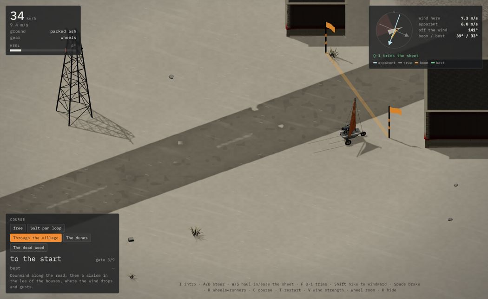
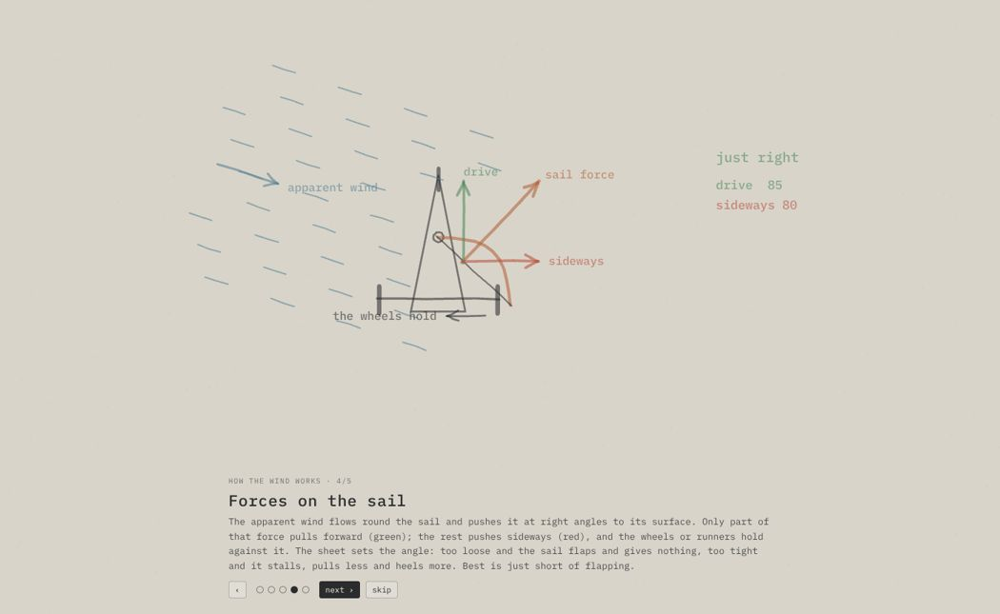
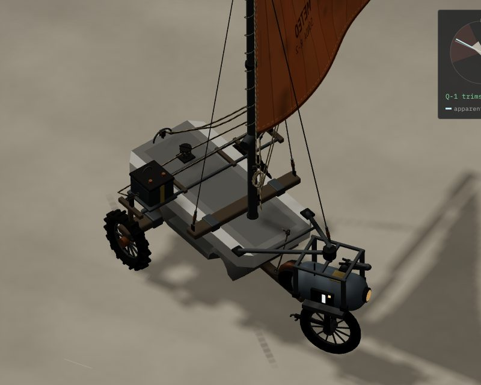

# Tech demo „Żegluga” (`/demo-sail/`)

Link: https://wjurkowlaniec.github.io/power-and-ash/demo-sail/ (po angielsku: dopisz `?lang=en`).

Poligon głównej rozgrywki: jazda Żaglowozem po różnym terenie. Wojtek (2026-11-10): żegluga ma być realistyczna i dawać dobre czucie, ma być jednym z zajęć, które gracz naprawdę robi i do których chce wracać: szkwały, cień wiatru za budynkami, różny teren pod kołami, przyjemnie, malowniczo, czasem trudno, z umiejętnością do złapania. Do tego intro, w którym wiatr i siły na żaglu są pokazane łagodnie, minimalnie, jak ręcznie rysowane.

## Co jest w demie

- **Mapa 400 × 400 m**: stara szosa (koła mkną, płozy szorują), solnisko (gładko i szybko, ale ślisko: w zakrętach zjeżdża bokiem), wydmy z sypkiego popiołu (koła grzęzną, płozy suną, pod górę i z góry), błotnisty strumień, wieś w ruinie ze żwirem, martwy las, wzgórza, linia słupów wzdłuż drogi. Za krawędzią teren podnosi się w wysokie wydmy.
- **Wiatr, który można czytać**: wieje z zachodu-północnego zachodu, powoli skręca i oddycha. Szkwały i flauty to plamy 12–35 m, które płyną z wiatrem, rosną i gasną. Na popiele szkwał widać jako ciemne, biegnące zmarszczki, a flautę i cień wiatrowy jako gładszy, jaśniejszy popiół. Smugi pyłu lecą z lokalnym wiatrem, więc za domami zwalniają i wirują. Chorągiewki bramek i proporczyk na maszcie pokazują wiatr w swoim miejscu.
- **Cień wiatrowy**: za domem, murem albo lasem wiatr siada na długość do ~10 ich wysokości, a na brzegach cienia szarpie i skręca. Gołe drzewa i kratownice słupów przepuszczają większość wiatru.
- **Trasy na czas**: pętla po solnisku, przez wieś, wydmy, martwy las. Pierwsza bramka włącza zegar, ostatnia go zatrzymuje, rekordy zapisują się w przeglądarce. Strzałka przy żaglowozie wskazuje następną bramkę.
- **Intro „Jak działa wiatr”**: pięć krótkich scen rysowanych ołówkiem na popielatym papierze, linie „drgają” jak w animacji rysowanej ręcznie: wiatr i szkwały, cień za domem, wiatr pozorny, siły na żaglu (siła żagla, ciąg, siła w bok, koła trzymają; łopotanie, w sam raz, przeciągnięcie), przechył (siła w bok wysoko, ciężar, oś obrotu, balast przeciągany na nawietrzną). Liczby w scenach liczy ten sam model, którym jeździ żaglowóz. Pokazuje się po starcie, później pod klawiszem **I**.

## Wolt jako przednie koło, balast i olinowanie (Wojtek 2026-11-10/11)

- **Wolt jest przednim kołem.** Nie siedzi na pokładzie, tylko jest wczepiony pod głowicę sterową na dziobie (rama A z burt wózka, siodło zaciśnięte na jego szynach dokowania). Skręca całym sobą, jego koło się toczy. Na płozach jego koło stoi w krótkiej płozie przypiętej pasami.
- **Silnik w piaście Wolta (E, wstecz Q)** pcha, gdy wiatr siądzie: najmocniej z miejsca (1,3 m/s²), coraz słabiej do ~6,5 m/s, i zjada baterię (pełna starcza na ~75 s pchania). Hamowanie (Spacja) odzyskuje trochę energii. Na płozach silnik nie pcha, bo koło nie dotyka ziemi. Wąska opona Wolta grzęźnie w sypkim popiele i błocie: dziób wyjeżdża tam szerzej, a silnik ciągnie słabiej.
- **Przesuwny balast (Shift)** zamiast wychyłu: skrzynia z baterią jeździ po szynie w poprzek burt. Shift ciągnie ją na nawietrzną (dojazd trwa ok. 0,4 s), puszczenie wraca ją na środek. Po zwrocie balast zostaje po zawietrznej i wtedy pomaga wiatrowi przewrócić żaglowóz, więc trzeba puścić i wcisnąć Shift jeszcze raz. HUD pokazuje położenie balastu i ostrzega „zawietrzna!”.
- **Olinowanie jest poprowadzone lina po linie, tak jak naprawdę by szło** (Wojtek: „sznurki, ma być tak dokładnie oddane”). Z bliska (kółko myszy przybliża teraz dużo mocniej) widać:
  - **szot grota**: zamocowany na bloczku na bomie, w dół do bloczka na pałąku na rufowej burcie, z powrotem przez bloczek na bomie (przełożenie 2:1), wzdłuż bomu do bloczka przy maszcie, w dół do bloczka przy pięcie masztu, po dnie wózka do przelotki na dziobie i na bęben kablowy Wolta, który go wybiera i luzuje (bęben się kręci). Gdy bom nie ciągnie (łopot, flauta, cień wiatru), talia zwisa luzem i buja się z żaglem; pod obciążeniem jest napięta;
  - **olinowanie stałe**: dwie wanty odchylone lekko do tyłu, do podwięzi na belce w poprzek burt, i sztag do głowicy sterowej; stalowa linka ze ściągaczami. Zawietrzna wanta luzuje się, gdy maszt opiera się na nawietrznej;
  - **obciągacz bomu** (talia z bomu do pięty masztu), **fał** przez rolkę na topie w dół do knagi, z nadmiarem zbuchtowanym, **sznurowanie liku przedniego** wokół masztu, róg szotowy i halsowy przywiązane do bomu;
  - **linka balastu**: pętla bez końca z obu stron skrzyni przez bloczki na końcach szyny i wokół kabestanu, który się obraca, gdy balast jedzie.
- Żagiel jest wolnolikowy (dolny lik nie jest przyszyty do bomu), dlatego wybrzusza się też przy bomie; trzymają go róg halsowy i szotowy.

Do zrobienia później: to samo w demie „Warsztat” (zamiast „wsiądź” ma być „wczep się z przodu”, a Żaglowóz ma dostać to samo olinowanie) i w grze.

## Sterowanie

| Klawisz | Co robi |
|---|---|
| A / D (strzałki) | ster |
| W / S | wybierz / poluzuj szot (wyłącza Q-1) |
| F | Q-1 trymuje szot sam (i luzuje, gdy żaglowóz zaczyna się unosić) |
| Shift | balast na nawietrzną (trzyma więcej; po zwrocie przerzuć) |
| E / Q | silnik Wolta: naprzód / wstecz (zjada baterię, nie działa na płozach) |
| Spacja | hamulec (odzyskuje trochę energii) |
| R | koła ↔ płozy (tylko na postoju, ~2,5 s) |
| C | następna trasa (albo przyciski w panelu trasy) |
| T | trasa od nowa |
| V | siła wiatru: słaby, zwykły, mocny |
| I | intro |
| kółko myszy | zoom (z bliska widać olinowanie) |
| H / M | ukryj pomoc / wycisz |

Linki: `?course=lake|village|dunes|forest` zaczyna na trasie, `?go` pomija kartę startową i intro, `?intro` otwiera od razu intro, `?debug` wystawia `window.sail` i `window.view`.

## Fizyka (src/sail/sim/landYacht.ts)

Czysty TS, testy w `test/sail.test.ts`.

- **Żagiel**: wiatr pozorny (rzeczywisty minus własna prędkość) trafia w żagiel pod kątem natarcia ustawionym szotem. Siła działa prostopadle do żagla (współczynnik `sailCn`: rośnie do kąta 0,3 rad, potem lekko spada; przy samym zera żagiel łopocze). Do przodu ciągnie tylko `sin(bom)` tej siły, reszta pcha w bok. Na półwietrze żaglowóz jedzie 2–2,5 razy szybciej niż wiatr, jak prawdziwe bojery.
- **Koła i płozy**: opór toczenia zależy od podłoża (koła: asfalt 0,015 g, sypki popiół 0,12 g; płozy odwrotnie), boczna przyczepność ma granicę, za nią żaglowóz zjeżdża bokiem (poślizg). Skręt przednim kołem, ale przy prędkości o zakręcie decyduje przyczepność: ostry skręt przy 15 m/s wypycha na zewnątrz.
- **Zbocza** ciągną w dół.
- **Przechył**: siła w bok działa wysoko (środek żagla), siła odśrodkowa na wysokości środka masy; trzyma ciężar na połowie rozstawu kół. Powyżej 1 nawietrzne koło się unosi (szybko i na krawędzi), za kątem wywrotki żaglowóz kładzie się na bok, a Wolt stawia go po ~3 s. Płozy (szerszy rozstaw) i balast na nawietrznej trzymają więcej; balast po zawietrznej skraca ramię. Uderzenie w przeszkodę szybciej niż 9 m/s też przewraca.
- **Silnik i bateria**: pchnięcie silnika maleje liniowo z prędkością i jest ograniczone przyczepnością przedniego koła; bateria 0..1 w `YachtState.energy`, hamowanie ładuje proporcjonalnie do prędkości.
- **Q-1 trymuje** szot do najlepszego kąta, a gdy przechył rośnie, luzuje go szybciej, niż wybiera. Ręcznie da się jechać ostrzej (i ryzykowniej).

## Pliki

| Plik | Co robi |
|---|---|
| `src/sail/sim/terrain.ts` | mapa: wysokość, pola podłoży (`surfaceFields`, wspólne dla fizyki i shadera), przeszkody |
| `src/sail/sim/windField.ts` | pole wiatru: wiatr bazowy, szkwały i flauty, cień przeszkód z turbulencją |
| `src/sail/sim/landYacht.ts` | fizyka żaglowozu |
| `src/sail/sim/courses.ts` | trasy, bramki, pomiar czasu |
| `src/sail/sim/sailGame.ts` | całość: mapa, wiatr, żaglowóz, trasa, rekordy, statystyki |
| `src/sail/render/sailView.ts` | scena 3D: teren z shaderem (krawędzie podłoży z pól, szkwały na popiele, cień), smugi pyłu, bramki z chorągiewkami, kamera |
| `src/sail/render/yachtRig.ts` | żaglowóz 3D: wózek z warsztatu, oś z kołami albo płozy, maszt, żagiel z balonu, Wolt w siodle na dziobie, balast na szynie, całe olinowanie |
| `src/sail/render/rope.ts` | liny i linki: rurka przez punkty przeliczana co klatkę (zwis, bujanie, zwoje), faktura skręconej liny |
| `src/sail/intro.ts` | intro rysowane na płótnie 2D |
| `src/sail/rollSound.ts` | szum kół na podłożu, łopot żagla |
| `src/sail/main.ts`, `sail.css`, `demo-sail/index.html` | HUD, sterowanie, strona |

Żaglowóz używa części z demo „Warsztat” (`mastRig`, `runnerRig`, `balloonSailTexture` z `src/craft/render/yachtModels.ts`, model wózka `spacetruck_trailer`) i wspólnego silnika (`Sail`, `woltMonoModel`, `WoltAnimator`, `GroundFx`, `Sound`). W `loadCraftModels` doszedł opcjonalny filtr `only`, żeby to demo ładowało tylko wózek, a `runnerRig(front = true)` może pominąć przednią płozę (tu przodem jest Wolt).

## Pomysł: Wolt jako przednie koło (Wojtek 2026-11-10, przyjęty 2026-11-11)

**Przyjęte i zrobione w demie „Żegluga”**: Wolt jest przednim kołem, wychył zastąpił przesuwny balast (wybór Wojtka na karcie decyzji), na płozach koło Wolta dostaje krótką płozę. Poniżej pierwotna ocena pomysłu.

Wojtek: „nie lepiej, żeby Wolt się wczepiał w Żaglowóz? Przednie koło jego”. Zamiast siedzieć na pokładzie, monocykl wjeżdża w widelec z przodu i sam staje się przednim, skrętnym kołem. Kapsuła jedzie na widelcu, lampa świeci przed żaglowozem, ramię sięga do szotu.

**Ocena agenta: dobry pomysł, lepszy niż pasażer.**

Za:
- Pasuje do świata: wózek ma już gniazdo dokowania dla monocyklu (SWIAT.md), ciała Wolta to moduły na ramie, a Żaglowóz staje się kolejnym „ciałem”.
- Sterowanie ma sens fizyczny: skręca koło Wolta, więc przyczepność przodu to przyczepność Wolta. Na sypkim popiele wąskie koło grzęźnie i przód ucieka.
- Nowe decyzje w jeździe:
  - Silnik w piaście Wolta może pchać, gdy wiatr siada (w flaucie, w cieniu za wsią, przy wyjściu z martwego kąta), ale zjada baterię.
  - Hamowanie kołem Wolta odzyskuje trochę energii.
  - Wiąże to żeglugę z bilansem prądu z reszty gry.
- Moment wczepienia i odczepienia to ładna animacja: klik, zamek, światło.

Koszty i co trzeba rozwiązać:
- Znika wychył na nawietrzną (Shift), bo Wolt nie może się przesunąć. Zastępstwa do wyboru:
  - przesuwny balast na pokładzie;
  - ramię Wolta, które przechyla maszt;
  - samo luzowanie szotu, odpadanie od wiatru i trym Q-1.
- Płozy: w bojerze przednia płoza skręca. Propozycja: na koło Wolta nakłada się krótką płozę. Druga opcja to zostawić koło, a wtedy przód grzęźnie na wydmach i to też jest wyzwanie.
- Rozstaw i stabilność bez zmian, ale masa przesuwa się do przodu: mniej podsterowności, łatwiej o obrót.

Jak by to weszło:
- **Demo „Żegluga”:** Wolt rysowany w widelcu zamiast na pokładzie, skręt jego kołem. Nowe klawisze: napęd silnikiem (zużywa baterię, pasek energii w HUD) i hamowanie z odzyskiem. Wychył zastąpiony jednym z powyższych. Intro: scena przechyłu bez wychyłu.
- **Demo „Warsztat”:** zamiast „wsiądź” jest „wczep się z przodu” (Wolt podjeżdża tyłem do widelca wózka), a zejście to odczepienie.

## Do sprawdzenia przez Wojtka

- Czy czucie jazdy jest dobre: prędkości (do ~70 km/h), jak łatwo się przewrócić, czy poślizg na solnisku nie jest za mocny.
- Czy szkwały są czytelne na popiele i czy smug pyłu nie jest za dużo.
- Czy mapa 400 m nie jest za mała przy tych prędkościach (łatwo ją powiększyć).
- Czy silnik Wolta nie jest za mocny albo za słaby, czy bateria starcza w sam raz i czy balast (Shift, przerzucanie po zwrocie) jest przyjemny.
- Czy olinowanie jest oddane tak, jak ma być, i czy czegoś brakuje.
- Czy intro jest w dobrym tonie i czy ma być też w grze, czy tylko w demie.
