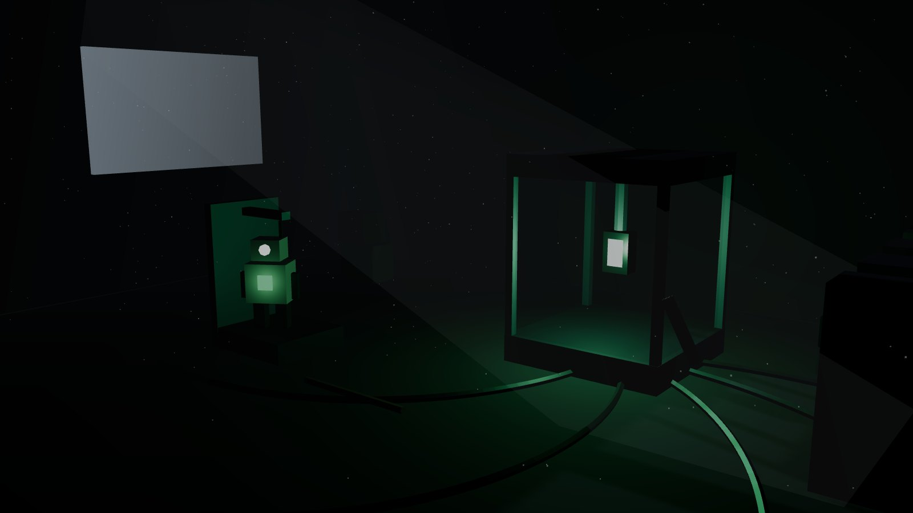
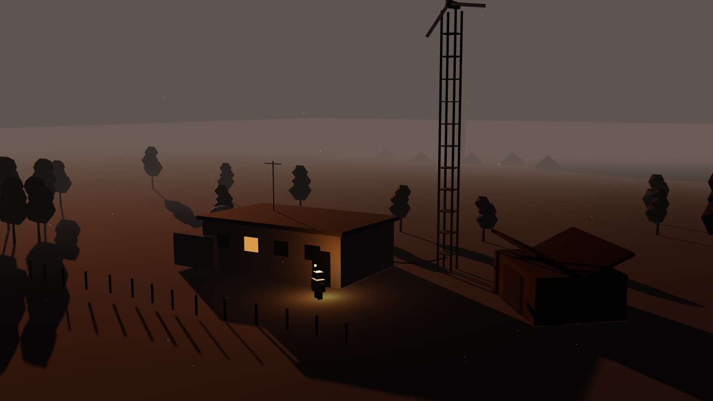
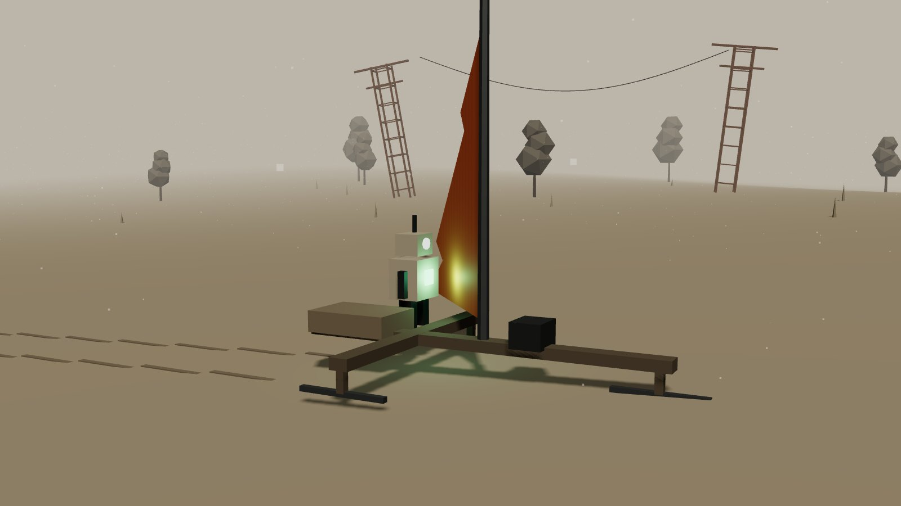
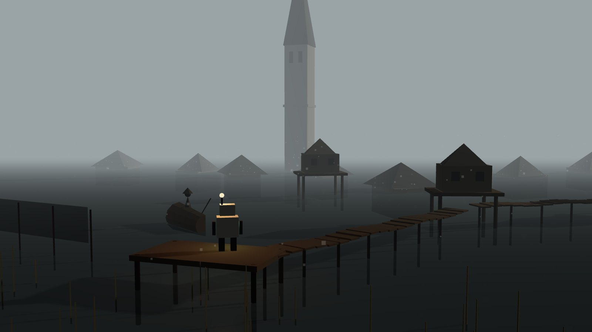

# Początek gry: od przebudzenia do pierwszej zimy

Dokument opisuje szczegółowo pierwsze godziny gry, scena po scenie. Ogólny świat i fabuła są w [SWIAT.md](SWIAT.md), a zasady kabla i obecny poziom testowy w [PLAN.md](PLAN.md).

Liczby (czasy, koszty, pojemności) to punkt wyjścia do strojenia w testach, a nie ustalenia.

## Założenia startu

- **Miejsce:** Stacja Pomiarowa „Olszanka”, polowa placówka misji badawczej, na skraju doliny z zalanym zbiornikiem. Dookoła łąki i olszyny przykryte cienką warstwą popiołu, jak szarym szronem. Na horyzoncie wieża kościoła wystająca z wody (Zatopiona Wieś).
- **Pora:** połowa jesieni. Do pierwszych mrozów zostaje ok. **20 dni gry**. To jest główny zegar pierwszego rozdziału, choć gracz nie musi o tym od razu wiedzieć.
- **Doba:** ok. 24 min realnych (ok. 15 min dnia, ok. 9 min nocy). Jesienią noce się wydłużają, czyli dzień po dniu jest coraz mniej słońca.
- **Wolt wie tyle co gracz:** nic. Pamięć wyzerowana, brak mapy, brak celu. Wszystko wychodzi z otoczenia.

## Scena 0. Ciemność (ok. 1 min)

Czarny ekran. Wiatr, skrzypienie blachy, kapanie wody. Co kilka sekund głuchy, niski puls, jak bicie serca przez ścianę. To bateria i to jest gracz: Wolt budzi się jako ogniwo zamknięte w komorze testowej, bez ciała.

Puls się wzmacnia, w ciemności pojawia się bladozielona kropka (jedyny kolor na ekranie). Szum obrazu, jak w starej kamerze. Bateria sięga przez kabel diagnostyczny do jedynej maszyny podpiętej do stanowiska: pustego automatu serwisowego na jednym kole, który stoi w kołysce. Obraz to widok z jego kamery, na **4% jego własnej rezerwy**. To pierwsze zdalne sterowanie w grze, choć gracz jeszcze tego nie wie.

Bez napisów i bez logo. Tytuł gry pojawia się dopiero w Scenie 4, gdy Żaglowóz pierwszy raz rusza.

## Scena 1. Hala pomiarowa (samouczek ruchu, ok. 5 min)

Pusty automat (ciało etapu 1, **monocykl**, patrz [SWIAT.md, Ciała i transfer](SWIAT.md#ciała-i-transfer)) stoi w kołysce serwisowej w hali stacji. Kołyska jest martwa. Obraz jest ziarnisty i czarno-biały, ruch powolny: bateria steruje ciałem zdalnie, po kablu, a ciało ma tylko resztkę własnej energii.

**Czego uczy:** ruch, rozglądanie się, interakcja (`E`), pasek energii i, po cichu, zdalne sterowanie: kabel diagnostyczny ogranicza, jak daleko ciało może odjechać od komory.

1. Ciało zjeżdża z kołyski i chwiejnie łapie równowagę na kole. Każdy metr kosztuje energię, a pasek widocznie spada (z 4% do ok. 2% w ciągu tej sceny). Presja jest delikatna, ale czytelna.
2. Pulsujące światło prowadzi do **stanowiska testowego**: przeszklona komora z ramieniem i kablami, w niej bateria (prototyp Q-1, oznaczenie na obudowie wytarte, czytelne tylko „Q-1” i znak misji: stylizowana zorza).
3. Komora jest zamknięta. Obok wisi ręczna dźwignia awaryjna. Pierwsza prosta zagadka: dźwignia ma za mało siły, więc trzeba ją podważyć rurą leżącą przy ścianie. Ciało ma od początku **ramię chwytne** i to nim bierze rurę (pierwszy przedmiot).
4. Ciało bierze baterię i wkłada ją w kasetę swojej ramy. Bateria przestaje sterować z zewnątrz i jest teraz w środku, na stałe. **Kluczowy moment gry:** dźwięk się otwiera, obraz nabiera koloru (wciąż wyblakłego), ruch staje się płynny. Pojawia się HUD: energia, temperatura, wilgotność.
5. Na ekranie stanowiska wyświetla się na sekundę fragment logu, zniekształcony: „…TEST 4411… STABILNY… NIE ODŁĄCZAĆ OD…” i obraz gaśnie. To pierwszy fragment fabuły. Obok stanowiska leży wydruk **raportu z testu 4411** (pierwsza notatka w Archiwum, patrz [SWIAT.md, Notatki i archiwum](SWIAT.md#notatki-i-archiwum)).

**Stan po scenie:** bateria daje energię, ale ma ograniczoną moc chwilową (np. 200 W). Wolt może pracować, lecz nie zasili całej stacji.

## Scena 2. Martwa stacja (energia, kabel, złom, ok. 15 min)

Stacja ma kilka pomieszczeń: hala pomiarowa, warsztat z fabrykatorem, maszynownia (akumulatory stacji, rozdzielnia), magazyn, dyżurka z oknem na dolinę. Na zewnątrz podwórze z masztem pomiarowym, małą turbiną wiatrową na szczycie, wyrzutnią balonów meteo i szopą.

Wszystko jest bez prądu. Drzwi do warsztatu mają elektryczny zamek.

**Czego uczy:** Wolt jako źródło prądu, porty, kabel, koszt energii, rozbiórka złomu, fabrykator.

1. Na drzwiach warsztatu wisi **kartka technika** („Zamek padł znowu. Jak nie ma prądu, wepnij się w port po lewej…”). To pierwsza notatka-wskazówka: zamiast okienka samouczka gracz dostaje podpowiedź od człowieka, który tu pracował. Przy drzwiach jest port. Wolt ma w ciele **krótki kabel własny (3 m)**, którym może się wpiąć w port i oddać trochę energii. Drzwi się otwierają, a pasek Wolta spada. Lekcja: każda rzecz, którą zasilasz z siebie, to Twoje życie.
2. W warsztacie stoi **fabrykator**, ale potrzebuje więcej mocy niż Wolt może dać. Prowadzi to do celu: uruchomić turbinę na maszcie.
3. **Pierwsze holowanie:** złom z podwórza jest za ciężki, żeby nosić go w ramieniu. Wolt doczepia do haka starą oponę i ciągnie na niej części jak na sankach. Monocykl zwalnia, ładunek zarzuca na zakrętach, a w popiele zostaje ślad. Lekcja: ciężar i lina zmieniają jazdę tak samo jak kabel.
4. Ta sama kartka wspominała łożysko i smar „w magazynie, druga półka”. Turbina stoi, bo **łożysko się zatarło** i łopata jest pęknięta. Pierwsza naprawa (samouczek maintenance): rozebrać złom na podwórzu (stara stacja meteo, przewrócony płot, skrzynki pomiarowe), zdobyć żelazo i smar, wymienić łożysko na szczycie masztu (wspinaczka po drabince, wiatr kołysze kamerą).
5. Turbina rusza, ale prąd z masztu trzeba doprowadzić do maszynowni. Kabel z nawijaka: pierwsze metry robi się w fabrykatorze… którego jeszcze nie da się zasilić. Rozwiązanie: w magazynie jest **szpula starego kabla, 12 m**, za krótka do maszynowni prostą drogą (ok. 15 m), ale wystarcza, jeśli poprowadzić kabel przez okno dyżurki. Pierwsza zagadka kablowa z owijaniem o przeszkody.
6. **Pierwsze świadome zdalne sterowanie:** przejście do maszynowni blokuje przewrócona szafa. Wolt wpina kabel w panel suwnicy w hali i steruje nią zdalnie, a jego ciało stoi w tym czasie bezczynnie przy panelu. Suwnica podnosi szafę. Prosta lekcja: możesz przejąć maszynę, ale zostawiasz wtedy własne ciało.
7. Maszynownia ożywa, światła w stacji zapalają się po kolei z charakterystycznym brzęczeniem. Fabrykator działa. Od teraz da się robić kabel (5 m = 1 miedź + 1 plastik, jak w poziomie „Rozruch”).
8. Stacja staje się **pierwszą bazą**: Wolt ładuje się w kołysce, a fabrykator działa tylko gdy wieje (akumulatory stacji są zdegradowane i trzymają mało).

**Fabuła w tej scenie:** w dyżurce jest tablica z kartkami (rysunki dzieci? zdjęcia zespołu?), kubek, kurtka na krześle. Ludzie stąd wyszli w pośpiechu. W szufladzie leży **notatka służbowa** kierowniczki stacji, która odmawia przeniesienia Q-1 do laboratorium (pierwszy ślad wątku „Spór o Q-2”). Na mapie ściennej ktoś zakreślił markerem siedem punktów połączonych linią (Sieć Siedmiu Stacji) i jeden punkt w górach, przekreślony.

## Scena 3. Pierwsza noc (temperatura, wilgoć, mikroboty, ok. 9 min)

Pierwsza noc przychodzi niezależnie od postępu, zwykle w trakcie Sceny 2 albo tuż po niej.

**Czego uczy:** temperatura i wilgotność Wolta, lampa, pierwsze zagrożenie.

1. Robi się ciemno i zimno. Na łąkę wchodzi mgła znad zbiornika. Wilgotność Wolta rośnie (osiada rosa), a gdy przekroczy próg, ruchy robią się szarpane i pojawiają się iskry.
2. Wolt może **się zgrzać** (przytrzymanie klawisza): suszy się, ale pali energię. Albo schować się w stacji przy maszynowni, gdzie jest ciepło. Gracz uczy się, że noc na zewnątrz jest droga.
3. **Mikroboty:** na kablu z turbiny pojawiają się małe, migające punkciki, jak świetliki. Przyczepiają się do kabla i podjadają prąd, a fabrykator zwalnia. Światło lampy Wolta je płoszy (rozpierzchają się z cichym szczebiotem). Na tym etapie są niegroźne, raczej zagadkowe i trochę piękne.
4. Rano kabel ma w kilku miejscach nadgryzioną izolację. Pierwszy znak, że kable się zużywają.

## Scena 4. Szopa i bojerek (budowa Żaglowozu, ok. 20 min)

W szopie na podwórzu stoi stara **rama bojerka**: żaglowe sanki z płozami, kiedyś do jazdy po lodzie zalewu. Ma złącze magistrali takie samo jak rama Wolta (pierwszy znak, że bojerek należał do misji). Później bateria będzie umiała sterować bojerkiem zdalnie, np. przyprowadzić go pod stację.

**Czego uczy:** budowa i rozwój pojazdu, sterowanie wiatrem, ładunek.

Do uruchomienia potrzeba:

| Część | Skąd | Uwagi |
|---|---|---|
| Płozy (3 szt.) | dwie w szopie, trzecia przy pomoście nad zbiornikiem | trzecia leży w mule: trzeba ją zaczepić liną do haka i wyciągnąć, cofając monocykl |
| Maszt | maszt anteny z dachu stacji albo rura z magazynu | wybór: antena daje lepszy maszt, ale stacja traci zasięg radia |
| Żagiel | **powłoka balonu meteo** z wyrzutni | pierwszy żagiel to cienka, pomarańczowa folia, szybko się strzępi |
| Liny i bloczki | magazyn | |
| Zasobnik na ładunek | skrzynka pomiarowa | 4 sloty |

1. Gracz składa bojerek w szopie. Każda część ma swoje miejsce i widać ją na modelu.
2. Pierwsza jazda: Wolt wjeżdża monocyklem w ramę, wpina się w złącze, stawia żagiel. **Tytuł gry pojawia się na ekranie** na tle doliny, gdy bojerek po raz pierwszy łapie wiatr.
3. Płozy suną po popiele i suchej trawie. Na kamieniach i asfalcie hamują i się ścierają. Na mokrej łące grzęzną. Teren od razu ma znaczenie.
4. Sterowanie: wiatr ma kierunek i siłę (widoczny na żaglu i chorągiewce). Pod wiatr się nie jedzie, trzeba halsować albo pchać. To jest ten sam system wiatru co w obecnym prototypie.

**Wybór z masztem** jest pierwszą decyzją gracza, która ma konsekwencję: bez anteny stacja nie wyśle alarmu, gdy mikroboty zaczną zjadać kabel podczas nieobecności Wolta.

## Scena 5. Echo (otwarcie świata, ok. 30 min i dalej)

Po pierwszej jeździe bateria zaczyna **pulsować kierunkowo**: im bliżej celu, tym szybciej. To umiejętność **Echo**, pierwsza z baterii. Na brzegu ekranu pojawia się delikatny łuk światła wskazujący kierunek.

Echo prowadzi w stronę Zatopionej Wsi, ale świat jest od teraz otwarty. Gracz może jeździć po dolinie, zbierać złom, rozbudowywać stację.

W dolinie (obszar startowy):

- **Rozdzielnia polowa** z małą baterią słoneczną (600 W) za ścianą kontenerów. To jest obecny poziom testowy „Rozruch”: pierwsze ładowanie pojazdu z obcego źródła i pierwszy dłuższy kabel (20 m). W docelowej grze to pierwsza wyprawa poza stację.
- **Wiatrak** na wzgórzu: stary, drewniany, z prądnicą dobudowaną przez misję. Druga baza do adaptacji, ale jego prądnica ma inny standard złącza. Pierwsza **analiza protokołu**: Wolt musi spędzić noc w stacji, „ucząc się” złącza, zanim zbuduje przejściówkę.
- **Przystanek** z wiatą, gdzie leży czyjś plecak: konserwy, latarka, zeszyt z rysunkami. Rysunki pokazują ludzi schodzących pod ziemię i robota bardzo podobnego do Wolta. Podpisy są odręczne i na razie nieczytelne. Odszumią się dopiero ze słownikiem (wątek „Dzieci ze Szkoły”).

## Scena 6. Pierwszy człowiek (ok. dzień 6–10 gry)

Na brzegu zbiornika Wolt znajduje ślady: odciski butów w popiele, jeszcze ciepłe ognisko, rozwieszone sieci rybackie.

1. Kiedy podjedzie bliżej, widzi postać w masce i płaszczu. Człowiek mówi coś, ale gracz słyszy tylko **szum z pojedynczymi tonami**. Napisy to rząd znaków, które się trzęsą.
2. Człowiek się boi. Rzuca kamieniem albo celuje z prowizorycznej włóczni i ucieka łodzią w stronę wieży kościoła.
3. Jeśli Wolt nie podejdzie zbyt szybko i nie zaświeci lampą w twarz, człowiek przed ucieczką zostawia na pomoście **przedmiot**: rozładowaną latarkę. To pierwsza „prośba” w języku gestów.
4. Gdy Wolt naładuje latarkę (z siebie albo w stacji) i zostawi ją w tym samym miejscu, następnego dnia czeka tam odpowiedź: zawiniątko z miedzianym drutem i wyrysowaną mapką. Pierwsza wymiana. Do słownika wpada pierwsze słowo: „światło”.

Od tego momentu ludzie stają się częścią gry. Zatopiona Wieś ma bunkier w schronie pod szkołą, a do niego trzeba będzie dotrzeć, ale bojerek nie jedzie po wodzie, a w wodzie i wilgoci Wolt rdzewieje. Pierwsza brama metroidvanii jest widoczna, zanim da się przez nią przejść.

## Scena 7. Pierwsza zima (koniec pierwszego rozdziału, ok. dzień 15–20)

Od ok. 15. dnia przychodzą przymrozki. Rano na kablach jest szron, akumulatory stacji tracą pojemność, a Wolt na zewnątrz w nocy wychładza się szybko.

Gracz dostaje jasny sygnał (zamarznięta kałuża, sypiący się szron, bateria pulsuje nerwowo): **zimy jeszcze nie przetrwasz**.

Opcje zimowiska:

- **Stacja Olszanka:** znana, bezpieczna, ale akumulatory stacji przez zimę padną i trzeba je będzie wiosną wymienić.
- **Schron pod szkołą** w Zatopionej Wsi, jeśli gracz zdążył nawiązać kontakt z ludźmi i zdobyć powłokę na wilgoć. Lepsza nagroda: ludzie przez zimę dbają o Twój sprzęt, a Ty o ich światło. Po przebudzeniu słownik jest dłuższy, bo Wolt „słyszał” ich przez sen.

Przed snem gracz wybiera **długość hibernacji** (patrz SWIAT.md). Przy pierwszej zimie dostępne jest tylko „do wiosny”, żeby nie zgubić się na start. Dłuższe opcje pojawiają się, gdy gracz ma coś, co produkuje przez lata.

Hibernacja to krótka sekwencja: ekran gaśnie, puls baterii zwalnia, za oknem sypie śnieg, potem topnieje. Wiosna: ten sam kadr, ale zieleń przebija się przez popiół, kabel jest pokryty mchem, a na pomoście stoi ktoś nowy.

## Co gracz ma po pierwszym rozdziale

- Baza: Stacja Olszanka (turbina, fabrykator, kołyska ładowania) i być może wiatrak.
- Żaglowóz etap 1: bojerek na płozach z żaglem z balonu i zasobnikiem 4 sloty.
- Wolt: bateria z Echem w ciele monocyklu z dodatkami (ramię od startu, hak holowniczy, nawijak, lampa), kabel własny 3 m, grzanie. Pierwsze zdalne sterowanie po kablu (dźwig, suwnica).
- Pierwsze słowa w słowniku i pierwszy kontakt z ludźmi.
- Kilka notatek w Archiwum: raport z testu 4411, kartka technika, notatka służbowa, zeszyt z rysunkami.
- Wiedza: kable się zużywają, noc jest droga, wilgoć szkodzi, mikroboty ciągną do prądu.

## Jak to się ma do obecnego prototypu

| Obecny prototyp | Miejsce w docelowej grze |
|---|---|
| Poziom testowy „Rozruch” (złom, fabrykator, kabel 20 m, ładowanie, odjazd) | Scena 5: wyprawa do rozdzielni polowej w dolinie |
| Żaglowóz z gotowym fabrykatorem | późniejszy etap Żaglowozu (etap 2–3), nie start |
| Wiatr i żagiel z logo „Zefir” | system wiatru od Sceny 4; logo „Zefir” na żaglu z etapu 2 (prawdziwe płótno z reklamą znalezione w Zatopionej Wsi) |

Proponowana kolejność budowy: najpierw Scena 1–3 w stacji (najmniej nowych systemów, dużo klimatu), potem bojerek i wiatr.
