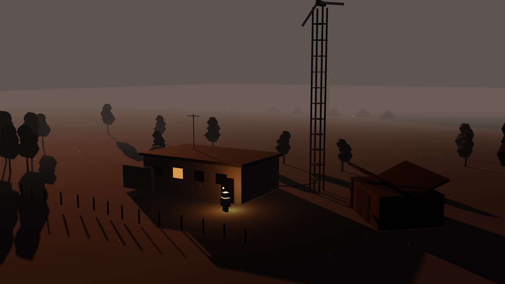
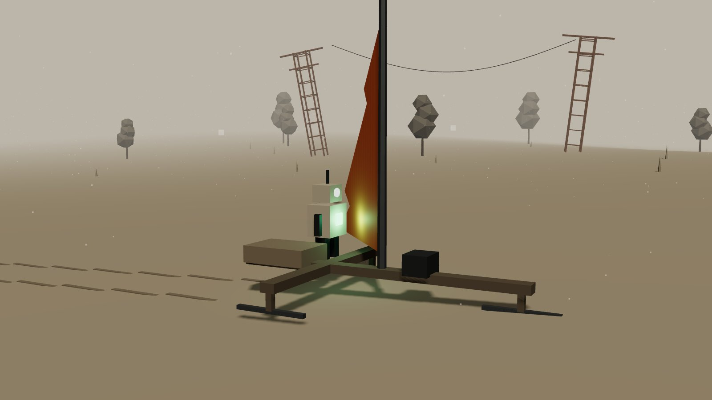
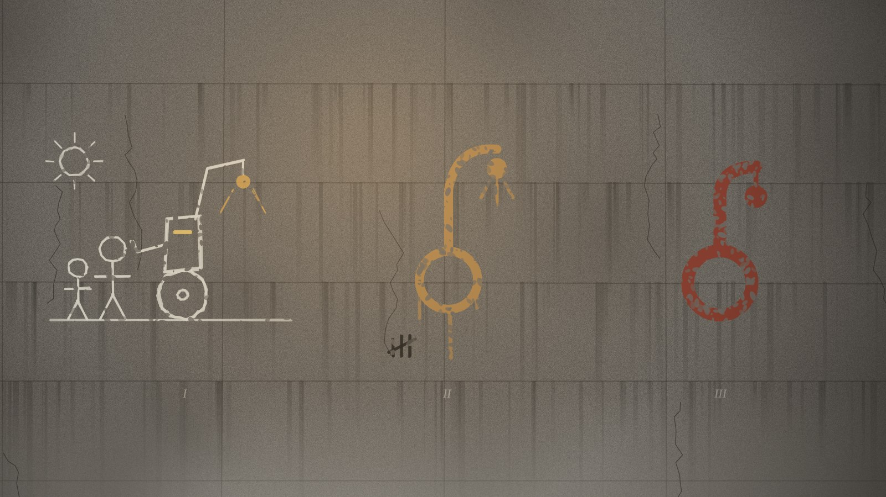
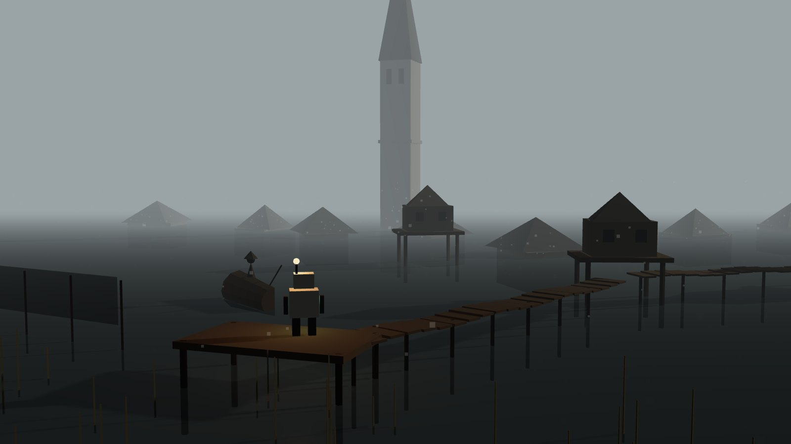
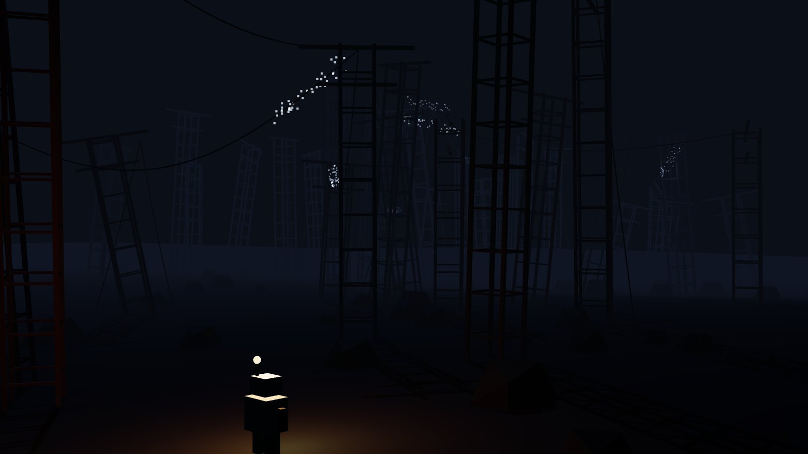
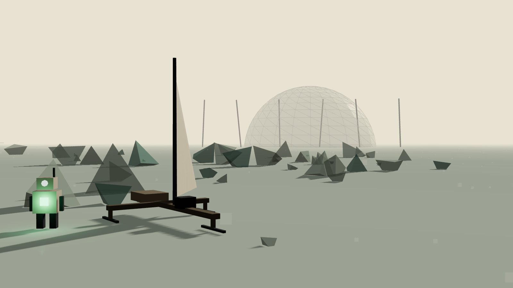
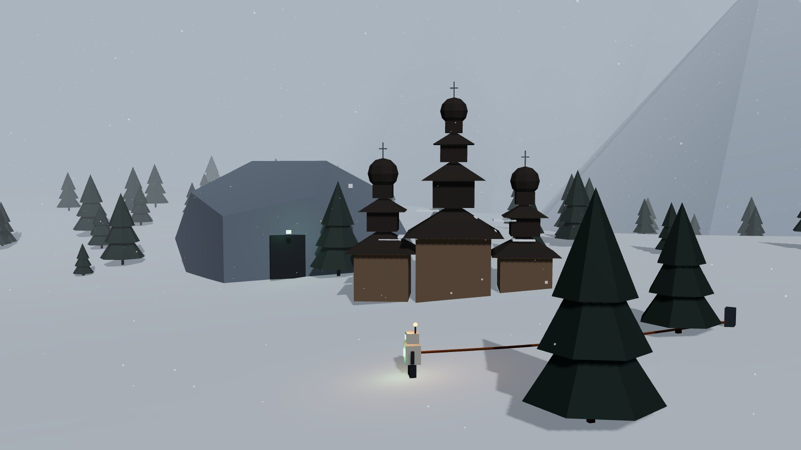
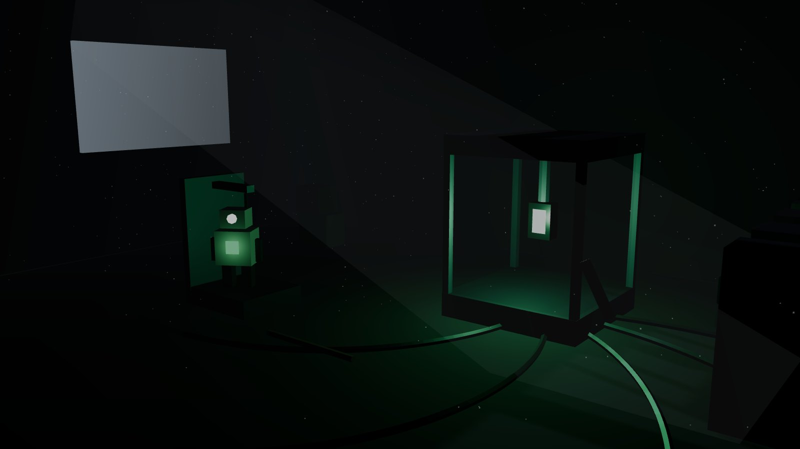

# Świat i fabuła

Dokument roboczy z rozmowy projektowej (listopad 2026). Szczegółowy przebieg pierwszych godzin gry jest w [POCZATEK.md](POCZATEK.md), a mechaniki kabla i obecny poziom testowy w [PLAN.md](PLAN.md). Lista wszystkich decyzji z datami jest w [DECYZJE.md](DECYZJE.md).

Oznaczenia: **[ustalone]** to decyzja Wojtka, **[propozycja]** to mój pomysł do akceptacji albo wyrzucenia.

## Spis

1. [W jednym akapicie](#w-jednym-akapicie)
2. [Ton i styl](#ton-i-styl)
3. [Historia świata](#historia-świata)
4. [Bateria Q-1](#bateria-q-1)
5. [Ciała i transfer](#ciała-i-transfer)
6. [Notatki i archiwum](#notatki-i-archiwum)
7. [Wolt](#wolt)
8. [Ładowanie](#ładowanie-zawsze-przez-fizyczne-połączenie)
9. [Rozwój: obliczenia w tle](#rozwój-obliczenia-w-tle)
10. [Żaglowóz](#żaglowóz)
11. [Ludzie i bunkry](#ludzie-i-bunkry)
12. [Czas: doba, pory roku, hibernacja](#czas-doba-pory-roku-hibernacja)
13. [Bazy](#bazy)
14. [Zagrożenia](#zagrożenia) (w tym dzikie zwierzęta i jeleń)
15. [Długofalowe skutki](#długofalowe-skutki-propozycja)
16. [Mapa świata i obszary](#mapa-świata-i-obszary)
17. [Łuk fabularny](#łuk-fabularny)
18. [Gra po fabule](#gra-po-fabule)
19. [Otwarte pytania](#otwarte-pytania)

## W jednym akapicie

Wolt to kwantowa bateria, prototyp z misji badawczej, która myśli i steruje ciałami maszyn. Budzi się w stacji pomiarowej jako jedyna rzecz w okolicy, która się ruszyła, przejmuje pusty automat serwisowy na jednym kole i od tej pory zawsze jest w jego ramie. Ciało rozbudowuje, a później steruje zdalnie innymi maszynami i przenosi się do innych ciał. Przeskalowana bateria mogłaby dać światu nieograniczoną, czystą energię. Ludzie przetrwali w bunkrach i brakuje im prądu. Wolt przez wiele lat, z hibernacjami na zimę, odkrywa, czym jest, czyli czym jest bateria, uczy się ludzi, adaptuje stare bazy i odbudowuje sieć energii. Gra nie kończy się wraz z fabułą. **[ustalone]**

## Ton i styl

- **Samotność i cisza jak w Inside.** Historia opowiadana otoczeniem, prawie bez tekstu. Żadnych dialogów w dymkach na początku gry. **[ustalone]**
- **Przyszłość, ale europejska.** Krajobraz i przyroda środkowej Europy: łąki, olszyny, mokradła, zbiorniki zaporowe, łagodne wzgórza, a dalej góry. Architektura nie amerykańska, ale też bez kiczu PRL-u czy PGR-ów: ma być czuć Europę w kształcie terenu, materiałach i proporcjach. **[ustalone]**
- **Paleta:** wyblakła, popielna. Kolor zarezerwowany dla ważnych rzeczy: blade okienko i dioda kasety baterii, sodowa lampa Wolta, miedziany kabel, przekaźniki, światła bunkrów.
- **Dźwięk:** ambient otoczenia (wiatr, woda, metal, owady, odległe brzęczenie linii). Bateria ma własny, niski puls, który jest emocjonalnym „głosem” gry.
- **Popiół** pokrywa świat cienką warstwą jak szary szron. Wiosną przebija się przez niego zieleń, latem robi się kurz, jesienią mokra breja, zimą miesza się ze śniegiem.



## Historia świata

**[propozycja]** Poniższa oś czasu jest szkieletem. Gracz poznaje ją we fragmentach z notatek (patrz [Notatki i archiwum](#notatki-i-archiwum)), w dowolnej kolejności, i nigdy nie dostaje jej podanej wprost.

| Okres | Co się stało |
|---|---|
| **Przed** | Europa żyje z rozproszonej, przeciążonej sieci. Kryzysy energetyczne są coraz częstsze. Powstaje **Program Zorza**, misja badawcza szukająca nowego źródła energii. |
| **Zorza** | W laboratorium w górach (Cerkwiska) zespół buduje prototyp **Q-1**: baterię, która nie tylko magazynuje energię, ale powoli ją „dobiera” ze zjawisk kwantowych. Do obsługi stacji polowych misja tworzy automaty serwisowe. Wolt jest jednym z nich. Powstaje sieć polowych stacji pomiarowych (Sieć Siedmiu Stacji). |
| **Próba** | Q-1 działa w małej skali. Ktoś (rząd? korporacja? sami naukowcy?) naciska, żeby od razu zbudować wersję przemysłową **Q-2**. |
| **Popiół** | Uruchomienie Q-2 kończy się katastrofą. To, co miało dobierać energię, zaczyna ją wysysać z otoczenia: z sieci, z maszyn, z żywych rzeczy. Fala przechodzi przez kraj w jedną noc. Zostaje popiół i martwa elektronika. To jest prawdziwe źródło popiołu i najmocniejszy zwrot fabularny. |
| **Zejście** | Ludzie uciekają pod ziemię: do schronów, kopalń, piwnic. Laboratorium jest zamknięte. Q-1, jedyny stabilny prototyp, zostaje w stacji polowej Olszanka z uśpionym automatem. |
| **Teraz** | Wiele lat później. Coś (echo innego prototypu? sygnał z laboratorium? sam Q-1?) budzi Wolta. |

Konsekwencja dla gry: ludzie, którzy pamiętają Popiół, mają dobry powód, żeby bać się baterii. Część chce ją zniszczyć, część mieć dla siebie. Wolt niesie w piersi rzecz, która może uratować świat albo powtórzyć katastrofę.

## Bateria Q-1

- **Serce i umysł Wolta, oś fabuły.** Bateria jest inteligencją i to ona steruje. Ciało jest narzędziem (patrz [Ciała i transfer](#ciała-i-transfer)). **[ustalone]**
- **Przedmiot bazowy, który rośnie:** z czasem odblokowuje kolejne umiejętności, niekoniecznie w kolejności fabularnej. **[ustalone]**
- **Bateria zawsze jest w Tobie.** Nie oddaje się jej do analizy. Analiza odbywa się przez wpięcie całego Wolta w jednostkę analityczną: przez ten czas ciało stoi unieruchomione w kołysce, a gracz może tylko zdalnie sterować tym, co ma pod kablem. Momenty przetrwania biorą się teraz z ciała zostawionego bez opieki. **[ustalone, zastępuje „wyjęcie baterii”]**
- **Śmierć:** ciało pada, a bateria przetrwa w swojej kasecie. Powoli stawia ramę bazową w trybie awaryjnym (gołe koło monocyklu), którą da się doturlać do bazy. Albo przejmuje najbliższą maszynę pod kablem. Karą jest stracony czas. **[ustalone]**

Umiejętności baterii (kolejność orientacyjna):

| Umiejętność | Co daje | Status |
|---|---|---|
| **Echo** | kierunkowy puls w stronę innych prototypów i obiektów misji, kompas fabularny | ustalone |
| **Zasięg** | dłuższe i stabilniejsze zdalne sterowanie, najpierw po kablu, potem radiowo | propozycja |
| **Impuls EMP** | rozprasza mikroboty i zakłóca obce maszyny, kosztuje dużo energii | ustalone (później) |
| **Rezonans** | ładuje urządzenia w pobliżu bez kabla, na krótki dystans | propozycja |
| **Pamięć miejsc** | zapasowe ciała w bazach, do których bateria wraca po śmierci | propozycja |
| **Dobieranie** | bateria powoli sama się ładuje z otoczenia, ale przy tym coś „wysysa” (rośliny więdną, mikroboty uciekają). Echo katastrofy Q-2. | propozycja |

### Pomysł w rozważaniu: kto naprawdę steruje **[do decyzji, Wojtek 2026-11-09]**

**Pomysł Wojtka (zwrot fabularny):** na początku bateria jest „kwantowa” albo po prostu nieznanego pochodzenia. Później okazuje się, że steruje nią człowiek z innego wymiaru, połączony z nią w jakiś sposób, jakby z innego wszechświata.

**Uwagi agentów (nie decyzja):**

- **Mocna strona:** pasuje do tego, że gracz od pierwszej sekundy *jest* baterią. Zwrot nadaje graczowi rolę w świecie: to Ty jesteś tym człowiekiem po drugiej stronie. Samotność jak w Inside dostaje drugie dno, bo samotny jest też ktoś po drugiej stronie.
- **Ryzyko:** słowo „multiwersum” jest wytarte. Lepiej, żeby to połączenie nigdy nie zostało do końca wyjaśnione, a człowiek po drugiej stronie miał własne, małe, konkretne życie (pokój, pora dnia, kubek, zmęczenie), widoczne tylko we fragmentach.
- **Połączenie z notatkami:** bateria odkodowuje pismo etapami z korpusu (patrz [Notatki i archiwum](#notatki-i-archiwum)). Korpus może powoli odsłaniać, że wśród zapisków są ślady języka i myśli tamtego człowieka, np. dopiski, których nikt w tym świecie nie mógł zrobić.
- **Do pogodzenia z kanonem:** dziś bateria „jest inteligencją”, a system uczący się liczy w tle. Wersja zgodna: bateria jest łączem i pamięcią, a decyzje (gracz) przychodzą z drugiej strony. Wtedy „uczenie się” to uczenie się nawzajem obu stron. Popiół po Q-2 mógłby być skutkiem połączenia, które poszło źle.
- **Kiedy ujawnić:** późno (rozdział „Zorza” albo po nim), z wcześniejszymi drobnymi rysami, np. Echo czasem odpowiada na coś, czego nie ma na mapie.

## Ciała i transfer

**[ustalone kierunkowo, 2026-11-06]** To bateria jest inteligencją i to ona naprawdę steruje. Ciało jest narzędziem. Bateria **zawsze jest w Tobie**, nie oddajesz jej nikomu, ale możesz **zdalnie sterować innymi maszynami** i z czasem **przenosić się do innych ciał**. Ciało ma wspólną ramę bazową, którą się rozbudowuje: najpierw monocykl, potem Latarnik i dalej.

### Rama bazowa i etapy ciała **[propozycja]**

Każde ciało Wolta to **rama bazowa** (kaseta na baterię, złącze magistrali, gniazda modułów) i moduły, które się do niej dokłada. Rozbudowa idzie jak przy żaglowozie: z części znalezionych w świecie, krok po kroku, ręcznie.

| Etap | Ciało | Co umożliwia |
|---|---|---|
| 1 | **Monocykl**: rama na jednym kole z żyroskopem, **ramię chwytne od samego startu**, hak holowniczy, lampa | start: szybki na twardym, bezradny na schodach, piasku i błocie, mało miejsca na ładunek |
| 2 | Monocykl z dodatkami: drugie ramię, nawijak kabla, mały bagażnik | kabel, rozbiórka złomu, noszenie części |
| 3 | **Latarnik**: wózek na kołach z lampą na wysięgniku, większy akumulator i więcej gniazd | dłuższa praca poza bazą, światło na mikroboty, praca w ciemnych miejscach |
| 4+ | warianty pod teren: płozy, gąsienice, krocząca rama na stoki, pływaki | bramy metroidvanii (piasek, mokradła, góry, woda) |

Wymiana modułów odbywa się w bazie albo przy żaglowozie. Zestaw modułów to w praktyce **ekwipunek i klasa naraz**: pod Szklany Zalew bierzesz chłodzenie i płozy, w góry grzałki i kroczącą ramę.

### Ramię i holowanie **[ustalone 2026-11-06]**

- **Ramię jest od startu**, w fabule i w grze. To nim ciało wyjmuje baterię z komory i wkłada ją w swoją ramę. Ramieniem Wolt podnosi rzeczy, przestawia dźwignie, rozbiera złom i trzyma kabel.
- **Holowanie:** Wolt może doczepić coś do siebie i ciągnąć za sobą na linie albo haku: starą oponę, palety cegieł, skrzynkę, kawałek blachy jako sanki, później przyczepkę.
- **Konsekwencje [propozycja]:**
  - ciężar spowalnia i przechyla monocykl, a na zakrętach ładunek zarzuca, więc trzeba jechać łagodnie;
  - ciągnięty ładunek ryje w popiele ślad, a na piasku i błocie stawia duży opór;
  - lina holownicza, jak kabel, zahacza o rogi i owija się o przeszkody;
  - kabel i lina naraz to ryzyko splątania: oba wychodzą z tyłu ramy, więc kolejność odpinania ma znaczenie;
  - ramię zajęte trzymaniem kabla nie podniesie niczego innego.
- **Zastosowania:** opona jako pierwsze „sanki” do zwożenia złomu, wyciąganie płozy z mułu, przeciągnięcie przeszkody, później przyczepka zamiast bagażnika.

### Zdalne sterowanie **[propozycja]**

Bateria może przejąć sterowanie inną maszyną: po kablu (od początku), a później radiowo, gdy ma antenę i zna protokół tej maszyny.

- **Co można przejąć:** dźwig w porcie, drona pomiarowego, pompę, suwnicę w hali, stary automat strażniczy, wózek kopalniany, a później sam żaglowóz.
- **Koszt i ryzyko:** gdy sterujesz czymś zdalnie, Twoje ciało stoi bez ruchu tam, gdzie je zostawiłeś. Marznie, moknie, a mikroboty mogą podgryzać jego akumulator. To zastępuje dawne „wyjęcie baterii” jako moment napięcia: zawsze ryzykujesz ciało, które zostawiłeś.
- **Zasięg:** po kablu tyle, ile kabla, a przez radio tyle, ile sięga antena. Kable i anteny, czyli sieć, stają się więc też siecią sterowania.
- **Protokoły:** zanim przejmiesz nowy typ maszyny, system uczący się musi go przeanalizować (obliczenia w tle). Notatki techników z instrukcjami przyspieszają analizę.
- **Zastosowania:** zagadki (dźwig podnosi kontener, a Wolt stoi przy porcie), zwiad dronem przed burzą, praca w dwóch miejscach naraz, obrona bazy. To też naturalna furtka do automatyzacji w przyszłości: maszyna zostawiona w bazie z prostym zadaniem.

### Transfer **[propozycja]**

Późniejszy etap: bateria fizycznie przenosi się do innego ciała. Kasetę przekłada się do innej ramy, np. do mocnego ciała górskiego, a stare zostaje w bazie jako zapasowe. Na początku transfer wymaga pomocy (dźwigu, drugiej maszyny sterowanej zdalnie), później ciało potrafi samo wysunąć kasetę i wpiąć się w nową ramę.

### Co z tego wynika dla fabuły **[propozycja]**

- Notatki z testu 4411 sugerują, że ogniwo „uczy się” i że zespół nie był pewien, kto kim steruje: automat ogniwem czy ogniwo automatem.
- Zwrot: **Wolt to bateria**, a nie robot. Imię „Wolt” dostał automat serwisowy, ale prawdziwa ciągłość to ogniwo, które przechodziło przez kolejne ciała.
- Ludzie, którzy to zrozumieją, zaczną traktować Wolta inaczej: jako kogoś, a nie coś. Albo jako zagrożenie, bo potrafi przejąć każdą maszynę.

## Notatki i archiwum

**[ustalone 2026-11-06]** Bateria zostaje kwantowa. Historię opowiadają **znajdowane notatki**, w klimacie archiwum z Control: urzędowe raporty z testów, notatki służbowe, prywatne zapiski. Różne historie różnych ludzi, a w notatkach są też **wskazówki, jak coś zrobić**.

**[ustalone 2026-11-08]** Bateria to obca inteligencja, która **nie rozumie ludzkiego pisma**. Na początku każda kartka i książka to dla niej ciąg znaków bez znaczenia. Mimo to warto je zbierać: gdy zbierze się ich wystarczająco dużo, pismo da się **odkodować**. Notatki to więc najpierw kolekcja zagadek, a dopiero później historie i wskazówki.

Dzięki temu bateria nie jest „magią”, tylko projektem badawczym, który miał swoje procedury, spory, błędy i ludzi. Gracz składa obraz z dokumentów, a nie z narratora.

### Rodzaje notatek **[propozycja]**

| Rodzaj | Wygląd | Co niesie |
|---|---|---|
| **Raport z testu** | druk z nagłówkiem Programu Zorza, numer testu, tabelki, fragmenty zaczernione | twarde fakty o Q-1: pomiary, anomalie, procedury bezpieczeństwa |
| **Notatka służbowa** | krótki memo: od kogo, do kogo, temat, podpis | decyzje i spory w programie (kto naciskał na Q-2, kto był przeciw) |
| **Instrukcja i schemat** | kartka przypięta do szafy, schemat odręczny, naklejka na urządzeniu | **wskazówki do rozgrywki**: jak ominąć zamek, które złącze z którym, kolejność uruchamiania, przepis do fabrykatora |
| **Prywatny zapisek** | kartka w kieszeni kurtki, zeszyt, list, rysunek dziecka | ludzie z misji i z bunkrów: strach, nadzieja, codzienność |
| **Dziennik automatu** | plik w pamięci innego robota, czytany po wpięciu kabla | zapisy maszyn misji, czasem pamięć zdarzeń, których nikt z ludzi nie widział |
| **Nagranie** | taśma w dyktafonie, poczta głosowa w centrali bunkra | głosy ludzi; przed nauką słownika to szum, po nauce mowa |
| **Ślad bunkrowy** | napisy kredą, tablice ogłoszeń w bunkrach, listy obecności | życie ludzi po katastrofie, nowe pokolenia po hibernacji |

### Zasady **[propozycja]**

- **Notatki są przedmiotami w świecie**, nie ikonkami do zbierania: kartka na biurku, podkładka na drzwiach, naklejka na szafie, książka na półce. Wolt podnosi je i skanuje, a kopia trafia do **Archiwum** w jego pamięci, na początku jako nieczytelne znaki.
- **Archiwum** porządkuje notatki według ludzi, miejsc i wątków. Zebrane notatki jednego wątku układają się w historię.
- **Odkodowywanie pisma [ustalone 2026-11-08, szczegóły to propozycja]:** każda zeskanowana kartka i książka dokłada tekst do **korpusu**. System uczący się (sama bateria, patrz [Rozwój](#rozwój-obliczenia-w-tle)) mieli go w tle, gdy ma nadwyżkę prądu. Po przekroczeniu kolejnych progów pismo się odszumia, a wszystkie zebrane wcześniej notatki od razu zyskują znaczenie. Ta sama kartka czytana później mówi więcej.
  - Książki są cenne: jedna książka to tyle tekstu, co kilkadziesiąt kartek. Szczególnie słowniki, podręczniki i instrukcje.
  - Progi (orientacyjnie): najpierw liczby, jednostki i znaki ostrzegawcze; potem częste słowa i druk techniczny (raporty, instrukcje); potem zwykły druk; na końcu odręczne pismo i gwara bunkrów.
  - Odszumianie wygląda jak w słowniku mowy: znaki w tekście płynnie zmieniają się w litery, słowo po słowie. Najpierw czytelne są pojedyncze słowa, więc gracz zgaduje resztę.
  - Mowa ludzi i pismo to dwa osobne, ale powiązane postępy: słowa poznane w rozmowie pomagają w piśmie i odwrotnie.
- **Zaczernienia:** część raportów ma zaczernione fragmenty. Pełne wersje odblokowuje analiza baterii (obliczenia w tle) albo znalezienie innej kopii tego samego dokumentu w innej bazie.
- **Wskazówki na początku są obrazkowe:** skoro tekstu nie da się przeczytać, wczesne podpowiedzi niosą rysunki, schematy, strzałki, piktogramy i liczby na kartkach (np. szkic portu ze strzałką „w lewo”, rysunek łożyska i półki). Pełna treść wskazówki staje się czytelna dopiero po odkodowaniu. Wtedy stare kartki zdradzają skróty i przepisy, których gracz wcześniej nie zauważył.
- Notatka z instrukcją liczy się też jako obserwacja dla systemu uczącego się, więc przyspiesza analizę danego urządzenia, nawet zanim da się ją przeczytać.
- **Bez przymusu:** fabułę da się przejść, nie czytając wszystkiego. Notatki nagradzają ciekawość: skrótem, przepisem, zrozumieniem.

### Wątki historii **[propozycja]**

| Wątek | Kto | O czym | Gdzie notatki |
|---|---|---|---|
| **Zespół Olszanki** | kierowniczka stacji, technik, meteorolożka | codzienność stacji polowej, opieka nad Woltem, ostatnie dni przed ewakuacją | Stacja Olszanka, dolina |
| **Test 4411** | zespół laboratorium | jak Q-1 zaczęła się stabilizować i co było w niej dziwnego | Stacja Olszanka, Cerkwiska |
| **Spór o Q-2** | dyrekcja Programu Zorza, naukowcy przeciw | kto i dlaczego naciskał na skalowanie | Las Słupów, wieża radiolinii, laboratorium |
| **Noc Popiołu** | ludzie w różnych miejscach tej samej nocy | ta sama noc z wielu stron, każda notatka dodaje szczegół | wszędzie, w różnych bazach |
| **Dzieci ze Szkoły** | dziewczynka z zeszytu z rysunkami, później dorosła | robot z bajki, który kiedyś wróci; jej życie między hibernacjami Wolta | Zatopiona Wieś, przez wiele lat gry |
| **Strażnicy** | ludzie z Klasztoru | dlaczego pilnują laboratorium i czego się boją | Cerkwiska |

### Przykłady

Tak notatki wyglądają **po odkodowaniu**. Przed odkodowaniem gracz widzi ten sam układ (nagłówek, tabelki, podpis, rysunki), ale tekst to nieczytelne znaki.

> **PROGRAM ZORZA · RAPORT Z TESTU 4411**
> Prototyp Q-1, stanowisko polowe Olszanka.
> Od 03:12 ogniwo oddaje więcej energii, niż przyjęło w cyklu ładowania. Nadwyżka 0,4%. Powtórzone trzykrotnie. ████████ nie potwierdza błędu pomiaru.
> Zalecenie: NIE ODŁĄCZAĆ OD AUTOMATU SERWISOWEGO. Ogniwo stabilizuje się wyłącznie pod obciążeniem.

> **Kartka na drzwiach warsztatu (pismo techniczne):**
> Zamek padł znowu. Jak nie ma prądu, wepnij się w port po lewej, wystarczy chwila. I NIE ZOSTAWIAJ TURBINY Z TYM ŁOŻYSKIEM, smar jest w magazynie, druga półka. — T.

> **Notatka służbowa**
> Do: dyrekcja Programu. Od: kierowniczka stacji Olszanka.
> Temat: przeniesienie Q-1 do laboratorium.
> Odmawiam. Q-1 jest stabilne tylko u nas, z naszym automatem. Jeśli ktoś chce budować Q-2 na danych z czterech miesięcy, niech podpisze to sam.

> **Zeszyt z rysunkami (pismo dziecka, początkowo nieczytelne):**
> Mama mówi, że robot ze stacji śpi i że jak się obudzi, to zapali światło w szkole.

## Wolt

- Dba o **temperaturę i wilgotność**: może się zgrzać, żeby wyschnąć, ale energia jest ograniczona. **[ustalone]**
- Ulepsza siebie. **[ustalone]**
- Pętla rozgrywki zawsze wraca do bazy albo żaglowozu. **[ustalone]**

Parametry Wolta **[propozycja]**:

| Parametr | Zagrożenie | Jak sobie radzić |
|---|---|---|
| Energia | wszystko ją zużywa: ruch, lampa, grzanie, zasilanie urządzeń z siebie | ładowanie w bazie, z paneli, ze stacji, z kabla |
| Temperatura | przegrzanie w słońcu (Szklany Zalew, lato), wychłodzenie nocą i zimą | cień, chłodzenie, grzałki, izolacja |
| Wilgotność | mgła, woda, rosa, deszcz: iskrzenie, szarpane ruchy, w końcu zwarcie | grzanie, osuszacz, powłoka |
| Zużycie ciała | stawy, serwa, oko | wymiana części, smar |

**Rdza** **[ustalone 2026-11-09, szczegóły propozycja]:** wilgoć i czas bez smarowania dają rdzę na stawach, kole i ramieniu. Zardzewiały Wolt jedzie wolniej, ruchy są szarpane i zużywa więcej prądu, a w końcu część się blokuje. Lekarstwo to oliwienie (olej jako materiał zużywalny, np. z beczek, później z roślin) i wymiana elementów. Rdzę widać na modelu i słychać (skrzypienie koła coraz głośniejsze). Dotyczy też wózka, żaglowozu i masztów sieci.

Ulepszenia Wolta to zamienne moduły na ramie bazowej (patrz [Ciała i transfer](#ciała-i-transfer)): izolacja, radiator, osuszacz, mocniejsza lampa, dłuższy kabel własny, nawijak o większej pojemności, czujniki (wilgotność gruntu, prąd w ziemi, ślady mikrobotów).

## Ładowanie: zawsze przez fizyczne połączenie

**[ustalone 2026-11-08]** W tym świecie nie ma ładowania bezprzewodowego ani indukcyjnego. Wolt ma zawsze przy sobie **mikrokabel** gotowy do podłączenia albo wpina się **bezpośrednio ramieniem** (decyzja Wojtka). Prąd zawsze płynie przez kabel albo styk. To wzmacnia główny temat gry (kabel, sieć, połączenia) i daje animacje, które pokazują, co się dzieje.

| Sposób | Gdzie | Jak wygląda | Animacja |
|---|---|---|---|
| **Ramię jako wtyczka** | każdy port w terenie, gdy Wolt stoi tuż przy nim | w nadgarstku ramienia jest bolec stykowy, a chwytak odsłania go jak klapkę | Wolt podjeżdża bokiem, ramię otwiera klapkę gniazda i wsuwa nadgarstek. Najszybsze, ale Wolt musi stać nieruchomo, a ramię jest zajęte (nie podniesie niczego ani nie trzyma kabla). |
| **Mikrokabel Wolta (3 m), zawsze pod ręką** | każdy port w terenie | wtyczka na krótkim przewodzie na bębenku przy ramie | Wolt staje przy porcie, ramię odwija wtyczkę, otwiera klapkę gniazda i wpina. Iskra, klik, dioda portu z czerwonej na bursztynową. Przewód leży naprężony między Woltem i portem, a odjazd ponad 3 m wyrywa wtyczkę. |
| **Kołyska / stacja dokująca** | tylko w bazach (hala stacji, później żaglowóz) | niska stalowa rampa z dwiema miedzianymi szynami i ramieniem stykowym nad nią | Wolt wjeżdża kołem na rampę, a ramię stykowe opada jak pantograf tramwaju i dociska się do styków na ramie. Krótki trzask, potem ciche buczenie. |
| **Kabel z nawijaka (20 m)** | między portami: stacja → pojazd, baza → baza | miedziany kabel z wtyczkami na obu końcach | jak w obecnej mechanice kabla |

**Wygląd portu w terenie:** metalowa skrzynka na słupku albo przy ścianie, wyblakła farba, uchylna klapka chroniąca przed popiołem, a pod nią okrągłe przemysłowe gniazdo wielopinowe. Obok mała tabliczka z numerem stacji, bursztynowa dioda stanu i zegarowy amperomierz, którego wskazówka drga podczas ładowania. Port jest czytelny z daleka dzięki diodzie i kształtowi klapki. Żadnych płaskich prostokątów.

**Uzasadnienie:** ładowanie bez kabla zabrałoby sens nawijakowi, kablom i rozbudowie sieci. Każde ładowanie ma za to swój koszt: Wolt stoi przy porcie, jest przywiązany przewodem, a w terenie to chwila, w której mogą podejść mikroboty.

## Rozwój: obliczenia w tle

**[ustalone kierunkowo]** Rozwój nie jest drzewkiem, które klika się za punkty, i nie jest przypięty sztywno do fabuły. Tym **uczącym się systemem** jest sama bateria (a później wspierają ją jednostki w bazach). To ona, który przy każdej interakcji z światem zbiera dane i powoli z nich wyciąga wnioski. Im więcej prądu, tym szybciej myśli.

**[propozycja] Jak to działa:**

- **Obserwacje.** Każda interakcja zostawia ślad: rozebrany złom, nowe złącze, obcy sprzęt, słowo usłyszane od człowieka, nieznany owad, nowy typ terenu. W rogu ekranu pojawia się dyskretny wpis, np. „nowa próbka: izolator ceramiczny” albo „nieznany protokół: 2 z 5 sygnałów”. Bez fanfar.
- **Obliczenia.** Obserwacje trafiają do kolejki. System przetwarza je w tle, ale **tylko gdy ma nadwyżkę energii**. Gdy Wolt ledwo zipie, nauka stoi. Gdy stoi przy wietrze i pełnych akumulatorach, przyspiesza. To spina rozwój z siecią: chcesz się uczyć szybciej, zbuduj więcej zasilania.
- **Odkrycia.** Gdy obliczenia się kończą, system „rozumie” coś nowego: przepis w fabrykatorze, przejściówkę do obcego złącza, ulepszenie Wolta, nowe słowo, sposób na mikroboty. Kolejność wynika z tego, co gracz robił, więc każdy gra trochę inaczej.
- **Moc obliczeniowa jako ulepszenie.** Na początku Wolt ma tylko podstawowy procesor: jedno zadanie naraz, wolno. Później:
  1. **Koprocesor** z rozbiórki sprzętu w stacji: dwa zadania naraz.
  2. **Jednostka analityczna** w bazie (np. stara szafa serwerowa z wieży radiolinii): liczy, gdy Wolta nie ma, ale potrzebuje stałego zasilania i chłodzenia.
  3. **Sieć baz:** połączone anteną bazy liczą razem. Daleka baza z wiatrakiem może całą zimę przerabiać dane, gdy Wolt śpi.
- **Hibernacja i nauka.** Długi sen z dobrze zasiloną bazą to dużo obliczeń. To jeden z powodów, dla których warto spać dłużej.
- **Analiza baterii** to największe zadanie obliczeniowe w grze, rozbite na etapy. Każdy etap to fragment prawdy o Q-1 i nowa umiejętność. Do niektórych etapów trzeba wpiąć całego Wolta w jednostkę analityczną, a ciało stoi wtedy unieruchomione.

**Przykład:** Wolt rozbiera stary falownik z wiatraka. Wpis: „nowa próbka: falownik, nieznany standard”. W nocy, gdy turbina daje nadwyżkę, system liczy przez dwie doby gry. Rano: „zrozumiano standard złącza wiatraka, dostępny przepis: przejściówka”. Gracz nie musiał nic klikać, ale gdyby turbina stała, czekałby dłużej.

## Żaglowóz

- **Budowany od zera przez całą grę.** **[ustalone]**
- **Maintenance:** żagiel się strzępi, łożyska się zapiaszczają, bateria traci pojemność, kable kruszeją. Rytm do ustalenia w testach. **[ustalone]**

Etapy **[propozycja]**:

| Etap | Pojazd | Co umożliwia |
|---|---|---|
| – | sam monocykl, ładunek na oponie za hakiem | okolice stacji, za mało prądu na dalej |
| 0 | **wózek serwisowy** z rozdzielni R-2: cztery małe koła z silnikami w piastach, mała platforma, gniazdo dokowania dla monocyklu, własna bateria **[ustalone 2026-11-07]** | twardy grunt, dłuższe trasy, ładunek; grzęźnie w sypkim popiele |
| 1 | wózek z masztem i żaglem z powłoki balonu meteo, płozy z ramy starego bojerka | popiół i wydmy, jazda na wiatr, oszczędzanie baterii |
| 2 | **sanie żaglowe**: dłuższa rama, prawdziwe płótno (wyblakła reklama „Zefir” z Zatopionej Wsi), wymienne płozy albo koła, mała bateria | dłuższe trasy, nocowanie przy pojeździe, pierwszy panel |
| 3 | **Żaglowóz**: kadłub z ładownią, fabrykator na pokładzie, turbina, panele, nawijak kabli | prawdziwa ruchoma baza, wyprawy na wiele dni |
| 4 | Żaglowóz rozbudowany: napęd elektryczny na bezwietrzne odcinki, kotwica i wyciągarka, izolacja, grzałki, powłoka | góry, mokradła, zima |

**Napędy w czasie** **[propozycja na podstawie luźnych myśli Wojtka, 2026-11-08]**: żagiel jest napędem początku, nie całej gry. Pod piasek i lód trzeba wymieniać koła na płozy (część zużywalna i decyzja przed wyprawą). Później przychodzą inne technologie (napęd elektryczny, potem coś, czego ludzie nie zdążyli zbudować), a na końcu np. **kwantowy poduszkowiec**, który nie potrzebuje ani wiatru, ani podłoża. Rytm podróży: na żaglu przejazd jest wolny, więc co 15–30 s gracz ma mieć coś do zrobienia (zbieranie po drodze, postoje, korekta żagla, omijanie przeszkód), a nie tylko patrzeć.



**Części zużywalne** **[propozycja]**:

| Część | Co ją niszczy | Objaw | Naprawa |
|---|---|---|---|
| Żagiel | wiatr, słońce, mróz | strzępi się, traci ciąg | łatanie, nowe płótno |
| Łożyska kół | piasek, popiół | piszczą, hamują, w końcu blokują koło | smar, wymiana |
| Płozy | kamienie, asfalt | ścierają się, gorzej suną | szlifowanie, wymiana |
| Bateria pojazdu | cykle ładowania, mróz | maleje pojemność | regeneracja, wymiana ogniw |
| Kable | słońce, mróz, mikroboty | iskrzą, tracą przewodność, pękają | taśma, wymiana odcinka |
| Liny i bloczki | wilgoć | trą, rwą się | wymiana |

Pojazd ma **kartę stanu** (klawisz), na której widać zużycie każdej części jak na rysunku technicznym. Naprawy robi się ręcznie, przy pojeździe.

## Ludzie i bunkry

- Żyją w bunkrach. Można robić dla nich misje: zdobywanie i dowożenie rzeczy, samotne trasy. **[ustalone]**
- Wolt na początku ich nie rozumie, a oni są dla niego zagrożeniem. **[ustalone]**
- **Słownik:** każdy kontakt dodaje słowa, a napisy stopniowo się „odszumiają”. **[propozycja, przyjęta w rozmowie]**

Jak działa słownik **[propozycja]**:

- Mowa ludzi to szum z tonami. Napisy to trzęsące się znaki.
- Słowa wpadają do słownika z kontekstu: człowiek pokazuje latarkę i mówi coś, a po wymianie to słowo staje się czytelne („światło”). Nauka idzie też przez obliczenia w tle.
- Przy ok. 30% słownika rozumiesz proste prośby, przy 60% zwykłe rozmowy, przy 90% wspomnienia i plotki, a w nich wskazówki fabularne.
- Każdy bunkier mówi trochę inaczej (gwara, żargon techników), więc słownik ma odmiany.

Bunkry **[propozycja]**:

| Bunkier | Gdzie | Kim są | Czego chcą | Stosunek do baterii |
|---|---|---|---|---|
| **Szkoła** | schron pod szkołą w Zatopionej Wsi | kilka rodzin, nauczycielka, dzieci; rybacy | światło, leki, części do pomp | ciekawość, dzieci widzą w Wolcie postać z bajek |
| **Rozdzielnia** | podziemna stacja przy Lesie Słupów | dawni technicy sieci | części, miedź, ochrona przed mikrobotami | chcą ją rozebrać i skopiować |
| **Klasztor** | piwnice przy cerkwiach w górach | strażnicy, którzy pilnują laboratorium | żeby nikt nie otworzył laboratorium | strach: pamiętają Popiół |
| **Kopuła** | Szklarnia pod Kopułą przy Szklanym Zalewie | ogrodnicy, którzy jako jedyni uprawiają rośliny | ogromnej ilości prądu, żeby kopuła przetrwała zimę | nadzieja, cel Sieci Siedmiu Stacji |

Typy misji **[propozycja]**: dostawa (przewieź coś przez trudny teren w określonym czasie), naprawa (przywróć prąd do pompy, wentylacji, światła), poszukiwanie (znajdź człowieka, sprzęt, nasiona), eskorta (przewieź człowieka żaglowozem, a on komentuje świat, co pomaga w słowniku), budowa linii (połącz bunkier z siecią).

## Czas: doba, pory roku, hibernacja

**[ustalone]** Start jesienią. Na początku Wolt nie przeżyje zimy, więc na zimę hibernuje, a **długość snu wybiera gracz**. Gra obejmuje wiele lat.

Pora dnia **[propozycja]**:

| | Dzień | Noc |
|---|---|---|
| Energia | słońce ładuje panele | tylko wiatr i akumulatory |
| Temperatura | ciepło, latem przegrzanie | chłód, zimą mróz |
| Wiatr | słabszy | mocniejszy, żaglowóz jedzie szybciej |
| Widoczność | mgła rano | ciemno, lampa przyciąga mikroboty |
| Zagrożenia | upał, ludzie w ruchu | mikroboty, wilgoć, zimno |

Pory roku **[propozycja]**:

| Pora | Charakter | Główne wyzwanie |
|---|---|---|
| Wiosna | roztopy, błoto, zieleń przez popiół, dużo wody | grząski teren, wilgoć, powodzie w Zatopionej Wsi |
| Lato | długi dzień, upał, susza, burze z piorunami | przegrzanie, pożary, ale dużo słońca |
| Jesień | mgły, deszcze, krótszy dzień | wilgoć, coraz mniej energii |
| Zima | śnieg z popiołem, mróz, zamarznięte wody | na początku nie do przeżycia, później zamarznięty zalew to autostrada dla bojerka |

Hibernacja **[propozycja]**:

- Spać można tylko w zimowisku (osłonięte, suche miejsce z zasilaniem podtrzymującym).
- Opcje: „do wiosny”, „rok”, „aż baza skończy zadanie”, „aż obliczenia się skończą”. Przy pierwszej zimie dostępne jest tylko „do wiosny”.
- **Co się dzieje w czasie snu:** bazy produkują, obliczenia idą (jeśli jest prąd), kable i sprzęt się zużywają, mikroboty się rozmnażają, ludzie żyją swoim życiem.
- **Po przebudzeniu:** krótka sekwencja „co się zmieniło”: zarośnięty kabel, nowy dom na palach, ktoś nowy na pomoście. W bunkrach mogą być nowi ludzie, którzy znają Wolta tylko z opowieści, a ktoś bliski mógł umrzeć.
- Długi sen jest kuszący (produkcja, nauka), ale świat się w tym czasie sypie, a ludzie mogą potrzebować pomocy, której nie dostaną.

## Bazy

**[ustalone, potwierdzone 2026-11-09]** Bez pełnego craftingu od zera, rozwój eksploracyjny (zob. [FABULA.md](FABULA.md)). Bazy to istniejące obiekty, które adaptujesz. Produkują rzeczy potrzebne do rozwoju, ale powoli (nawet rok). Trzeba je zasilać i doglądać. Żeby dostać alarm na odległość, trzeba zbudować antenę. Sprzęt z różnych baz nie jest kompatybilny i trzeba analizować protokoły.

Obiekty do adaptacji **[propozycja, szkoła ustalona]**:

| Obiekt | Gdzie | Rola po adaptacji | Problem do rozwiązania |
|---|---|---|---|
| **Stacja Olszanka** | start | pierwsza baza, kołyska ładowania, fabrykator | zdegradowane akumulatory |
| **Wiatrak** | wzgórze w dolinie | generator | obcy standard prądnicy (analiza protokołu) |
| **Szkoła ze schronem** | Zatopiona Wieś | zimowisko, kontakt z ludźmi | wilgoć, pompy |
| **Wieża radiolinii** | wzgórze nad Lasem Słupów | antena dalekiego zasięgu, jednostka analityczna | wysokość, burze, mikroboty |
| **Stacja transformatorowa** | Las Słupów | węzeł sieci, łączenie baz | uszkodzone uzwojenia |
| **Mała elektrownia wodna** | zapora zbiornika | duża, stała moc | zamulone turbiny, ludzie ze Szkoły z niej korzystają |
| **Szklarnia pod Kopułą** | Szklany Zalew | wielki odbiorca, cel sieci | potrzebuje ogromnej mocy |
| **Laboratorium Zorza** | Cerkwiska | analiza baterii, prawda o Q-1 | zamknięte, strzeżone, głęboko pod skałą |

Zasady baz **[propozycja]**:

- Każda baza ma **stan** (zasilanie, temperatura, zużycie) i **zadanie** (produkcja, obliczenia, ładowanie).
- Bez anteny nie wiesz, co się dzieje w bazie, dopóki tam nie dojedziesz. Z anteną dostajesz alarm (mikroboty na kablu, awaria, mróz).
- Adaptacja to głównie: oczyszczenie, naprawa, podłączenie do sieci kablem, przejściówki do obcych standardów.

## Zagrożenia

**[ustalone]** Głównie środowisko, do tego inne roboty i mikroboty żywiące się prądem.

| Zagrożenie | Gdzie i kiedy | Działanie | Obrona |
|---|---|---|---|
| Upał | lato, Szklany Zalew | przegrzanie Wolta i baterii | cień, chłodzenie, jazda nocą |
| Mróz | zima, noce, góry | wychłodzenie, kruche kable, słabsze akumulatory | grzałki, izolacja, zimowisko |
| Wilgoć | mgła, woda, deszcz | iskrzenie, zwarcia, rdza | grzanie, osuszacz, powłoka, oliwienie |
| **Dzikie zwierzęta** | o swoich porach, patrz niżej | przewracają, niszczą ładunek i części, atak z góry | pory przejazdu, odstraszacz, osłony |
| Burze | lato | pioruny w maszty i kable | uziemienie, a później łapanie energii z piorunów |
| Burza pyłowa | sucho, wietrznie | brak widoczności, ścieranie łożysk i płóz | schronienie, osłony |
| **Mikroboty** | noc, przy kablach i źródłach prądu | podżerają energię, nadgryzają izolację, w roju mogą wyssać baterię | światło, EMP, pułapki z przynętą, izolacja |
| Inne roboty | stare automaty misji i obce maszyny | niektóre bronią terenu, niektóre zbierają złom, niektóre da się przeprogramować | unikanie, EMP, analiza protokołu |
| Ludzie | na początku | boją się, rzucają kamieniami, mogą ukraść część | cierpliwość, wymiana, słownik |

**Mikroboty** **[propozycja]** to cała mała ekologia. Za dnia śpią w gniazdach (stare transformatory, słupy). Nocą wylatują do najbliższego prądu i wyglądają jak świetliki. Pojedyncze są niegroźne, ale rój na kablu potrafi zjeść całą nadwyżkę bazy. Są zwabiane przez światło i ciepło. Później da się je wykorzystać: oswojone gniazdo, które „czyści” linię z obcych rojów, albo przynęta odciągająca je od bazy.

**Walka** **[propozycja]:** Wolt nie ma broni. Odstrasza (światło, impuls EMP), zastawia pułapki, ucieka, przeprogramowuje. To pasuje do ciszy i tonu.

### Dzikie zwierzęta **[ustalone 2026-11-09, szczegóły propozycja]**

Zwierzęta są częścią świata i bywają przeszkodą. Niektóre przejścia są bezpieczne tylko o określonych porach, a stałe bezpieczne przejście wymaga zbudowania odstraszacza.

| Zwierzę | Gdzie i kiedy | Co robi | Jak sobie radzić |
|---|---|---|---|
| **Niedźwiedź** | olszyny i rzeki, świt i zmierzch, jesienią najaktywniejszy (żeruje przed snem zimowym) | przewraca Wolta, rozrywa holowany ładunek, niszczy części i kable | omijać jego pory, odstraszacz, jesienią trasa naokoło; zimą śpi, jak Wolt w hibernacji |
| **Sokół** (atak z góry) | otwarte równiny i maszty, za dnia | nurkuje na błyszczące części, lampę, antenę; gniazduje na słupach Sieci | osłony, nie jechać odkrytym terenem w południe, przenieść gniazdo, odstraszacz na maszcie |
| Inne (do wymyślenia) | | np. dziki ryjące wokół kabli, kruki kradnące drobne części | |

**Odstraszacz:** ma kosztować prąd, więc pasuje do mechaniki sieci. Przykłady: buczek akustyczny, migające światło, pastuch elektryczny na kablu, strach na wróble z blachy na maszcie. Zwierzęta z czasem się przyzwyczajają, więc odstraszacz trzeba co jakiś czas zmieniać albo przesuwać (patrz [Długofalowe skutki](#długofalowe-skutki-propozycja)).

**Ostrożnie z tonem:** to nie są przeciwnicy do walki (Wolt nie ma broni), tylko rytm świata, który trzeba czytać.

### Jeleń **[ustalone 2026-11-09, szczegóły propozycja]**

Jeden jeleń, który z czasem zaprzyjaźnia się z Woltem. Gdy Wolt wraca w jego okolicę, jeleń mu towarzyszy: najpierw dziko i z daleka, z każdym rokiem bliżej. Po latach umiera. Jest tylko ten jeden i tylko przez pewien czas gry.

- **Gdzie:** propozycja Dolina Olszanki, czyli okolica startu, do której się wraca.
- **Jak rośnie zaufanie:** Wolt nie podjeżdża za blisko, gasi lampę, zostaje w miejscu; jeleń podchodzi coraz bliżej, potem idzie obok, a w końcu sam ostrzega (zatrzymuje się i nasłuchuje przed niedźwiedziem).
- **Śmierć:** po kilku latach gry, najlepiej odkryta po przebudzeniu z hibernacji wiosną. Bez przerywnika, tylko miejsce, gdzie leży, a później poroże w trawie.
- **Po co:** to wczesny, mały przedsmak dużego tematu gry, czyli tego, że Wolt przeżyje wszystkich, dla których coś robi (patrz [Zakończenie bez ludzi](#pomysł-w-rozważaniu-zakończenie-bez-ludzi-do-decyzji-wojtek-2026-11-09)).

## Długofalowe skutki **[propozycja 2026-11-09, na prośbę Wojtka]**

Gra trwa wiele lat, więc to, co Wolt robi (albo zaniedbuje), powinno zostawać w świecie i się zmieniać. Zasada: każdy skutek ma być widoczny na ekranie, a nie tylko w liczbach.

| Obszar | Co się dzieje z czasem |
|---|---|
| **Rdza i zużycie** | Wszystko, czego nie oliwisz i nie naprawiasz, rdzewieje: maszty, kable, wózek, sam Wolt. Po długiej hibernacji świat jest bardziej zardzewiały niż przed nią. |
| **Infrastruktura bez opieki** | Nieodwiedzane linie i bazy niszczeją (zarastają, pękają kable, wpadają mikroboty), więc sieć trzeba objeżdżać jak gospodarz, a nie tylko budować. |
| **Ślady i drogi** | Często używana trasa wydeptuje się w ścieżkę, potem w drogę (szybsza jazda). Zwierzęta zaczynają ją omijać albo wręcz przeciwnie, z niej korzystać. |
| **Zwierzęta się uczą** | Odstraszacz działa coraz słabiej. Sokoły gniazdują na słupach Sieci. Gdy Wolt naprawia przyrodę, wraca więcej zwierząt: więcej jeleni, ale też więcej niedźwiedzi. Sukces ma koszt. |
| **Ekologia** | Popiół z roku na rok cienieje tam, gdzie działają technologie klimatyczne; wraca zieleń, mokradła, owady. Tam, gdzie nic nie zrobiono, zostaje szaro. Mapa po 20 latach wygląda inaczej niż na początku. |
| **Nieodwracalne decyzje** | Niektóre ruchy zmieniają teren na stałe, np. naprawa zapory zatapia dolinę jeszcze bardziej, a wycięcie Lasu Słupów otwiera przejazd i zabiera gniazda. |
| **Ludzie i pokolenia** **[przyjęte przez Wojtka 2026-11-09]** | Dzieci, które pamiętają Wolta, dorastają i się starzeją. Wolt staje się legendą i słowem w ich języku. **Ludzie malują na ścianach symbol Wolta** (pomysł Wojtka): najpierw rysunek dziecka, potem znak, który z pokoleniami się upraszcza, aż zostaje prosty piktogram: **kółko, na nim prostokąt, z prostokąta wystaje ręka** (Wojtek 2026-11-09). Gracz może go spotkać w bunkrach i ruinach jako ślad, że ktoś tu o nim pamiętał, a nawet daleko od miejsc, gdzie Wolt był, co znaczy, że legenda wędrowała sama. Kolejne pokolenia traktują go inaczej niż pierwsze. Łączy się z [Zakończeniem bez ludzi](#pomysł-w-rozważaniu-zakończenie-bez-ludzi-do-decyzji-wojtek-2026-11-09). |
| **Sam Wolt** | Patyna, łaty i wymienione części zostają na modelu. Po latach gracz widzi na ciele historię swoich napraw. Stare ciała zostają w bazach jak relikwie. |
| **Pamięć świata** | Miejsca, gdzie coś się stało (grób jelenia, pierwsza zapalona lampa, rozbity wózek), zostają na mapie jako małe znaki. |



Szkic: `img/koncepty/symbol-wolta.html` (`?sciana` albo `?zblizenie`). Prompt do generatora obrazów jest w `/mnt/project-files/koncepty/symbol-wolta/prompt-openai.md`.

Jak to policzyć technicznie (do decyzji później): świat ma prosty „zegar starzenia” na obiekt, który tyka szybciej przy wilgoci i braku opieki, a hibernacja przelicza go skokowo.

## Mapa świata i obszary

**[ustalone]** Jeden ciągły świat. Obszary otwierają się dzięki ulepszeniom Wolta i żaglowozu, a nie kluczom fabularnym. Zostają: Zatopiona Wieś, Las Słupów, Szklany Zalew, Cerkwiska.

Szkic układu **[propozycja]**:

```
                     CERKWISKA (góry, laboratorium)
                          ▲  stoki, mróz
                          │
   SZKLANY ZALEW ◄────── LAS SŁUPÓW ──────► (dalej: obszary do wymyślenia)
   (kopuła, upał)    sypki   (rozdzielnia,     
                     piasek   wieża radiolinii)
                          ▲
                          │  bród, mokradła
          ZATOPIONA WIEŚ ◄┴► POPIELNA RÓWNINA (open world od Sceny 6)
          (szkoła, zapora)    (wydmy popiołu, ślady dróg, trop z dziennika wózka)
                                ▲  wzgórze, za mało prądu
                                │
                          DOLINA OLSZANKI (start)
                          (stacja, wiatrak, rozdzielnia polowa R-2 w kotlinie)
```

### Dolina Olszanki (start)

- **Wygląd:** łąki, olszyny, rowy melioracyjne, polne drogi, rozpadające się wiaty przystanków. Popiół jak szron.
- **Dźwięk:** wiatr w trawie, żaby nad rowami, skrzypienie masztu.
- **Bazy:** Stacja Olszanka, wiatrak, rozdzielnia polowa R-2 z wózkiem serwisowym (obecny poziom testowy „Rozruch”).
- **Zasoby:** złom, miedź z płotów i skrzynek, plastik z pomiarówek, szkło.
- **Zagrożenia:** pierwsze mikroboty, noce, wilgoć.
- **Brama wyjścia:** wzgórze, na które sam monocykl ma za mało prądu, więc potrzebny jest wózek z R-2. Dalej bród i mokradła w stronę Zatopionej Wsi (potrzebne osuszanie).

### Popielna Równina **[propozycja, 2026-11-07]**

- **Wygląd:** szeroka, płaska równina za wzgórzem, dawne pola przysypane popiołem w wydmy. Wystają z niej słupy, dachy stodół, nasypy dróg. To jest „pustynia” z pomysłu Wojtka, ale z popiołu, a nie z piasku.
- **Dźwięk:** wiatr bez przeszkód, syk przesypującego się popiołu, daleki brzęk drutów.
- **Rola:** pierwszy otwarty obszar. Pojawia się po Scenie 5, gdy Wolt ma wózek.
- **Zasoby:** złom z porzuconych maszyn, rama starego bojerka (płozy), drut.
- **Zagrożenia:** zasięg (daleko do prądu), sypki popiół, burze pyłowe.
- **Brama:** twarde nasypy dróg są dla kół, a wydmy dopiero z płozami i żaglem.

### Zatopiona Wieś



- **Wygląd:** wieś zalana przez zbiornik zaporowy. Z wody wystaje wieża kościoła, dachy, korony drzew. Ludzie dobudowali domy na palach i kładki. Na brzegu zapora z martwą elektrownią wodną.
- **Dźwięk:** chlupot, krople, dzwon na wieży poruszany wiatrem, głosy z daleka.
- **Bazy:** szkoła ze schronem (zimowisko), elektrownia wodna na zaporze.
- **Ludzie:** bunkier Szkoła, pierwszy kontakt.
- **Zasoby:** płótno (reklama „Zefir” na starym magazynie), liny, części pomp.
- **Zagrożenia:** wilgoć, rdza, wiosenne powodzie, głęboka woda (Wolt tonie).
- **Brama wejścia:** osuszanie Wolta i powłoka. Później łódź albo pływaki do żaglowozu.
- **Wiosną** woda się podnosi i część kładek znika. **Zimą** zalew zamarza i robi się z niego tor dla bojerka.

### Las Słupów



- **Wygląd:** dawny pas linii wysokiego napięcia, gdzie po katastrofie ktoś (albo coś) stawiał kolejne słupy, aż zrobił się gąszcz martwych kratownic i zwisających drutów. Krzaki i brzozy rosną między nimi.
- **Dźwięk:** brzęczenie drutów na wietrze, trzaski, szczebiot mikrobotów nocą.
- **Bazy:** stacja transformatorowa, wieża radiolinii na wzgórzu.
- **Ludzie:** bunkier Rozdzielnia, technicy.
- **Zasoby:** dużo miedzi, izolatory, transformatory.
- **Zagrożenia:** gniazda mikrobotów, burze, splątane druty (kabel Wolta się zahacza).
- **Brama wejścia:** światło albo EMP przeciw rojom i dłuższy kabel.

### Szklany Zalew



- **Wygląd:** jezioro, które w noc Popiołu zamieniło się w taflę stopionego szkła. Lustro dla słońca, odłamki jak kry. W oddali kopuła Szklarni.
- **Dźwięk:** prawie cisza, cykanie stygnącego szkła, wiatr bez przeszkód.
- **Bazy:** Szklarnia pod Kopułą.
- **Ludzie:** bunkier Kopuła, ogrodnicy.
- **Zasoby:** szkło, panele słoneczne, nasiona.
- **Zagrożenia:** upał i odbicia słońca (przegrzanie), ostre odłamki niszczące płozy, burze pyłowe na brzegach.
- **Brama wejścia:** chłodzenie Wolta i płozy do szkła. Najlepsze miejsce na energię słoneczną w grze.

### Cerkwiska



- **Wygląd:** góry, świerki, drewniane cerkwie z gontowymi daszkami, śnieg przez większość roku. W skale ukryte wejście do Laboratorium Zorza.
- **Dźwięk:** wiatr na grani, skrzypienie drewna, cisza śniegu.
- **Bazy:** Laboratorium Zorza.
- **Ludzie:** bunkier Klasztor, strażnicy.
- **Zasoby:** sprzęt misji, dokumentacja, części do baterii.
- **Zagrożenia:** mróz, lawiny, strome stoki, strażnicy.
- **Brama wejścia:** grzałki i izolacja, kotwica i wyciągarka na stoki, zaufanie strażników albo sposób na ich ominięcie.

### Kolejne obszary **[do wymyślenia]**

Kierunek: nieoczywiste połączenia i europejski krajobraz. Pomysły do rozmowy: zalane kopalnie z podziemnym jeziorem, wydmy nadmorskie z wrakami, torfowiska, miasto na stokach przecięte autostradą.

**[propozycja 2026-11-08, do oceny przez Wojtka]** Na interaktywnej mapie świata (https://claude.ai/artifact/3Z4w4jbwc3H2CXB8BAyHtW) są trzy kandydaty: **Mierzeja Wraków** (nadmorskie wydmy z wrakami), **Miasto Tarasów** (miasto na stokach, ludzie żyją wśród martwych maszyn), **Zatopione Szyby** (zalane kopalnie z podziemnym jeziorem, Głębinowcy).

## Łuk fabularny

**[ustalone 2026-11-09]** Fabuła nie jest liniowa: są opcje, rozgałęzienia i wpływ na fabułę, ale da się zrobić 100%, i ma to wychodzić naturalnie. **Przepływ fabuły i drzewko decyzji są w [FABULA.md](FABULA.md)** i na mapie świata (widok „Przepływ fabuły”). Tam rozdziały 2–4 poniżej są równoległymi filarami w dowolnej kolejności, a nie kolejnymi latami (propozycja).

**[propozycja]** Fabuła jest otwarta, ale ma oś. Każdy rozdział to mniej więcej jeden rok gry.

1. **Przebudzenie** (rok 1): stacja, bateria, odjazd na resztce prądu, rozdzielnia R-2 i wózek, Popielna Równina, Echo, pierwszy człowiek, pierwsza zima. Szczegóły w [POCZATEK.md](POCZATEK.md).
2. **Ludzie** (rok 2): bunkier Szkoła, słownik, elektrownia wodna. Ludzie po raz pierwszy wspominają „noc, gdy zgasło wszystko”. Pierwszy etap analizy baterii.
3. **Sieć** (lata 3–5): Las Słupów, technicy, wieża radiolinii, łączenie baz anteną. Technicy chcą baterii. Zwrot: echo prowadzi do drugiego automatu misji, starszego i zepsutego, z fragmentami pamięci o Q-2.
4. **Kopuła** (lata 5–8): Szklany Zalew, ogrodnicy, zasilenie Szklarni przez zimę. Pierwsza duża zmiana świata, którą Wolt sam spowodował.
5. **Zorza** (później): Cerkwiska, strażnicy, laboratorium. Prawda o Popiele i decyzja: odtworzyć baterię w większej skali (ryzyko), oddać ją ludziom, czy zostawić w sobie i budować sieć powoli.

Decyzja na końcu nie zamyka gry, tylko zmienia świat dalej.

### Ironia losu **[propozycja na podstawie luźnych myśli Wojtka, 2026-11-08, nie dosłownie]**

Świat się poddał. Po katastrofie i zmianach klimatu ludzie cofnęli się w rozwoju, a jedyną rzeczą, która jeszcze ulepsza technologię, jest jeden robot. Wolt powoli wyprowadza ludzi z powrotem, mimo że bywają oporni.

- **Ironia podwójna:** Popiół spowodowała technologia z tej samej rodziny co bateria (Q-2), więc ludzi ratuje dokładnie to, czego się boją.
- **Cofnięcie bez jaskiń:** nie dosłowna epoka kamienia, tylko życie wśród martwych maszyn, których nikt już nie rozumie (np. Tarasowi, Głębinowcy).
- **„Dzikie technologie”:** Wolt (system uczący się) wymyśla rzeczy, których ludziom zabrakło, gdy zmienił się klimat, i w końcu przywraca dobre warunki. Kandydaci, głównie po fabule: **Wiązacz Popiołu** (oswojone mikroboty robią z popiołu glebę), łapacze mgły, siewnik chmur na wieży radiolinii, ogrody poza Kopułą.

### Pomysł w rozważaniu: zakończenie bez ludzi **[do decyzji, Wojtek 2026-11-09]**

**Pomysł Wojtka:** naprawa ziemi, infrastruktury i ekologii trwa kilkadziesiąt albo kilkaset lat. Zanim robot skończy, ludzie wymierają. Zostaje sam ze swoimi robocikami, bez ludzi, dla których to wszystko robił. Po drodze łuk relacji z ludźmi: najpierw potrzeba ich zrozumienia, potem poznania ich potrzeb, potem tego, jak im pomóc.

**Uwagi agentów (nie decyzja):**

- **Łuk z ludźmi już pasuje do kanonu:** zrozumienie to słownik i odkodowywanie pisma, potrzeby to misje bunkrów, pomoc to Sieć i technologie klimatyczne. Warto nazwać te trzy etapy wprost jako oś relacji.
- **Mocna strona:** gorzkie, ciche zakończenie w duchu Inside i ironii losu.
- **Ryzyko:** jeśli wymarcie jest stałe i nieuniknione, dziesiątki godzin misji dla ludzi mogą się wydać daremne, a „gra po fabule” traci sens.
- **Propozycja: niech to wynika z mechaniki, nie z przerywnika.** Czas już jest zasobem (hibernacja, której długość wybiera gracz, i obliczenia w tle). Ludzie się starzeją, pokolenia się zmieniają, a każda długa hibernacja kosztuje ludzkie życia. Gracz, który naprawia świat „optymalnie”, może zostać sam; ten, który wybiera ludzi zamiast tempa, zdąży choć części pomóc. Ironia jest wtedy zasłużona, a nie narzucona.
- **Połączenie ze zwrotem „kto naprawdę steruje”:** jeśli baterią steruje człowiek z drugiej strony, to w świecie bez ludzi ostatnim człowiekiem jest on, czyli gracz. Wolt nie jest wtedy całkiem sam. To spina oba pomysły w jedno zakończenie: robot robił wszystko dla ludzi, a jedyny, który został, był z nim od początku.

### Pomysł w rozważaniu: radio i milknące głosy **[do decyzji, Wojtek 2026-11-09]**

**Pomysł Wojtka:** gdy Wolt ma już radio i nawiąże kontakt z ludźmi, mogą go prosić o pomoc (mini misje). Z upływem czasu ludzi jest coraz mniej, a gracz musi dojść, dlaczego.

**Uwagi agentów (nie decyzja):**

- **Radio jako zegar ludzkości:** lista znaków wywoławczych bunkrów, która z czasem się przerzedza. Po każdej hibernacji część stacji milczy. Nikt tego nie ogłasza, gracz sam widzi, że kanał, który odzywał się co wieczór, przestał. To wprost przenosi „hibernacja kosztuje pokolenia” z [Zakończenia bez ludzi](#pomysł-w-rozważaniu-zakończenie-bez-ludzi-do-decyzji-wojtek-2026-11-09) na coś, co słychać.
- **Mini misje przez radio:** krótkie prośby (przywieź filtr, napraw pompę, poszukaj zaginionego), z terminem. Spóźniona pomoc ma skutek, bo bunkier może zamilknąć. Misje dają też słowa do słownika.
- **Dlaczego ich ubywa (do wyboru, można warstwowo):**
  1. **Powód widoczny:** popiół w płucach, mało dzieci, zimy, choroby. Gracz może temu częściowo zaradzić (filtry, ciepło, żywność).
  2. **Powód ukryty, najmocniejszy:** bateria. Umiejętność „Dobieranie” i cała sieć, którą Wolt buduje, powoli wysysa życie z otoczenia, jak echo Q-2. Im więcej prądu i pomocy, tym szybciej ludzie gasną. Ironia losu w czystej postaci, a gracz musi wybrać: mniej sieci albo mniej ludzi.
  3. **Powód zwrotny:** ludzie nie umierają, tylko odchodzą przez połączenie baterii na drugą stronę. Pasuje do zwrotu [kto naprawdę steruje](#pomysł-w-rozważaniu-kto-naprawdę-steruje-do-decyzji-wojtek-2026-11-09), ale osłabia gorycz zakończenia.
- **Rekomendacja agenta:** 1 + 2. Najpierw widzisz zwykłe przyczyny i z nimi walczysz, a później z notatek i pomiarów wychodzi, że część winy jest w Tobie.
- **Ostatni głos:** gdy kanały ludzi zamilkną, na radiu zostaje jeden słaby sygnał, którego nie da się namierzyć na mapie. To człowiek po drugiej stronie, czyli gracz. Spina wszystkie trzy pomysły.

## Gra po fabule

**[ustalone]** Gra ma być na długo, a nie na jedną misję.

**[propozycja]** Po głównym wątku zostaje:

- Rozbudowa Sieci Siedmiu Stacji do wszystkich bunkrów.
- Kolejne lata i pokolenia ludzi, z misjami, które z tego wynikają.
- Dalsze obszary i obliczenia (system uczy się do końca).
- Automatyzacja, gdy wrócimy do tematu: na razie tylko ręczne podpinanie.

## Otwarte pytania

- Czy wchodzą radio i milknące głosy, i dlaczego ludzi ubywa, patrz [Pomysł w rozważaniu](#pomysł-w-rozważaniu-radio-i-milknące-głosy-do-decyzji-wojtek-2026-11-09).
- Czy wchodzi zakończenie bez ludzi (ludzie wymierają, zanim robot naprawi świat), patrz [Pomysł w rozważaniu](#pomysł-w-rozważaniu-zakończenie-bez-ludzi-do-decyzji-wojtek-2026-11-09).
- Czy wchodzi zwrot „kto naprawdę steruje baterią” (człowiek z innego wymiaru), patrz [Pomysł w rozważaniu](#pomysł-w-rozważaniu-kto-naprawdę-steruje-do-decyzji-wojtek-2026-11-09).
- Czy Popiół jako skutek katastrofy Q-2 jest OK? To mocno ustawia ton i stosunek ludzi do baterii.
- Kto budzi Wolta i dlaczego teraz.
- Ile umiejętności baterii i w jakiej kolejności.
- Ile ciał i modułów, i które maszyny da się przejąć zdalnie.
- Czy transfer do innego ciała jest od połowy gry, czy dopiero późno.
- Ile notatek na obszar i jak bardzo mają prowadzić za rękę.
- Kolejne obszary poza czterema ustalonymi.
- Rytm psucia się żaglowozu i sprzętu.
- Walka: tylko odstraszanie czy coś więcej.
- Automatyzacja: kiedy i w jakiej formie.

## Koncept arty

Rendery są w `docs/img/koncepty/`, a źródło sceny w `docs/img/koncepty/scene.html` (Three.js, ujęcie wybiera się hashem, np. `#wies`). To szkice nastroju i kompozycji, nie docelowa grafika.

| | |
|---|---|
|  |  |
|  |  |
|  |  |
|  | |
