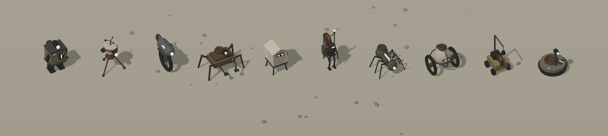
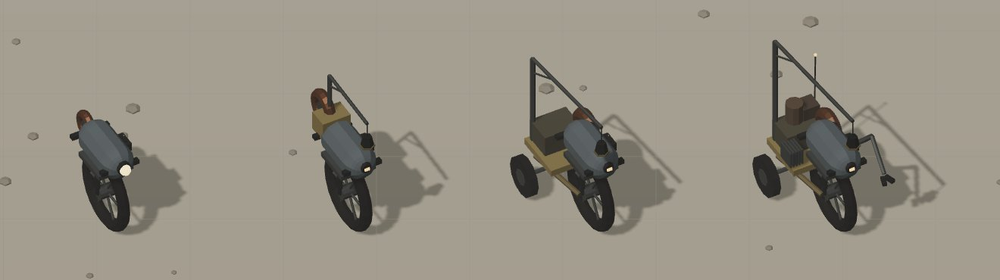

# Wygląd Wolta: warianty i wybrany kierunek

Materiały z wątku projektowego (2026-11-06). Wojtek poprosił o 10 wersji protagonisty. Powstały szkice 3D (strona z wariantami: https://claude.ai/artifact/Gsu5z4EwkZNkztDikPKS1U), ale Wojtek chciał wizualizacji z generatora obrazów zamiast renderów z gry. W chmurze nie ma generatora, więc wybrał wariant „same prompty”: [prompty.md](prompty.md) (po angielsku, pod Midjourney; `--ar` i `--no` usuń w innych generatorach).

Warianty: 1 Szafka, 2 Statyw, 3 Monocykl, 4 Krab, 5 Budka, 6 Tragarz, 7 Mrówka, 8 Kula w klatce, 9 Latarnik, 10 Krążek.

**Decyzja:** podobają się Monocykl i Latarnik, z wspólną bazą rozbudowywaną etapami (trochę jak droidy w Star Wars): E1 Rdzeń (koło + kapsuła z ogniwem Q-1), E2 Maszt (latarnia na wysięgniku), E3 Podwozie (rdzeń dokuje w ramę z dwoma kółkami), E4 Latarnik (ramię, radiator, antena, ładunek). Ramię jest od samego startu. W grze jest dziś etap E1 (`src/render/wolt.ts`). Fabularnie: [SWIAT.md, Ciała i transfer](../../SWIAT.md#ciała-i-transfer).

| Wszystkie warianty | Etapy rozbudowy |
|---|---|
|  |  |
